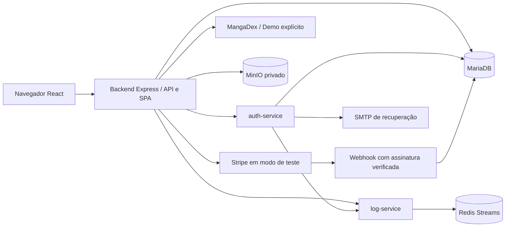

# Documentação técnica — MangaCloud

Atualizado em 12/11/2026. O MangaCloud permite descobrir obras, organizar estantes privadas e ler capítulos pela fonte externa. Esta documentação descreve o código atual; resultados e pendências ficam no [roteiro de continuidade](docs/ROTEIRO_CONTINUIDADE_MANGACLOUD.md).

A documentação da entrega anterior foi preservada integralmente como [registro histórico da P1](docs/historico/DOCUMENTACAO_P1.md).

## Serviços e comunicação

| Caminho | Responsabilidade |
| --- | --- |
| `frontend/src/pages` | Landing, catálogo, estantes, obra, leitor, perfil, assinatura e administração |
| `frontend/src/hooks` | Sessão, carregamento, paginação e progresso de leitura |
| `backend/src/app.ts` | Montagem da API, headers, erros, Swagger e SPA |
| `backend/src/routes` | Autenticação/proxy, estantes, leitura, perfil e cobrança |
| `backend/src/providers` | Fontes MangaDex e Demo, capítulos canônicos e manifesto |
| `backend/src/services` | Regras de biblioteca, storage e entrega de capas MangaDex |
| `auth-service/src` | Cadastro, login, recuperação de senha e gestão de papéis |
| `log-service/src` | Recepção de eventos internos e persistência em Redis |

O backend serve o frontend compilado e a API no mesmo endereço. A porta local prevista é `8224:3001`. A infraestrutura existente será revisada na etapa final de publicação; aliases e nomes físicos de rede/containers ainda preservam a instalação anterior.

## Dados e propriedade

O banco mantém usuários, estantes, itens, metadados de capas personalizadas, favoritos, progresso, assinaturas e eventos Stripe. Obras externas são referenciadas por `provider + manga_id`; capítulos por `provider + chapter_id`. O catálogo externo e as páginas não são copiados para tabelas locais.

`estantes` pertence a `usuarios`; `estante_itens` e `estante_capas` pertencem a `estantes`. Consultas e alterações filtram pelo dono autenticado. Terceiros recebem 404, inclusive administradores tentando abrir bibliotecas alheias. Favoritos e progresso também são privados.

O MinIO guarda avatares e capas enviadas pelo usuário em buckets privados. O backend valida tamanho, formato e dimensões, decodifica/reencoda uploads e entrega os arquivos pela API autenticada. Exclusões/substituições usam fila SQL de limpeza compensatória.

As capas do catálogo MangaDex são buscadas pelo servidor e entregues pela mesma origem, com validação e cache limitado em memória. Há restrição ao host/caminho da fonte e nenhuma URL arbitrária de cliente é aceita.

## Autenticação e permissões

- Cadastro público cria `leitor`.
- `leitor`, `curador` e `admin` organizam suas próprias bibliotecas.
- `curador` e `admin` acessam diagnóstico das fontes e totais da fila de limpeza.
- `admin` consulta usuários, altera papéis e visualiza auditoria.
- A API verifica JWT e reconsulta conta/papel no banco; esconder controles na interface não concede ou retira autorização.

Papel e assinatura são independentes. Pro depende de `assinaturas.status='active'` e `acesso_ate > UTC_TIMESTAMP()`. O booleano legado de usuário não autoriza leitura ou progresso.

## Catálogo, leitura e assinatura

MangaDex e Demo são namespaces explícitos. A aplicação apresenta falhas da fonte e permite ao usuário selecionar Demo; não substitui silenciosamente dados reais por fixtures.

Após autenticação, capítulos disponíveis no MangaDex podem ser lidos gratuitamente. O paywall didático cobre somente Demo: Free libera as três primeiras posições canônicas por obra/idioma; Pro libera o restante. A API autoriza o manifesto antes de fornecer URLs de páginas.

Pro também permite sincronizar capítulo/página. O servidor valida vínculo, idioma, intervalo de páginas e revisão esperada; uma gravação conflitante retorna 409. O leitor serializa saves por conta/obra/idioma na aba, preserva a identidade do capítulo e envia alterações pendentes ao sair. Falhas/conflitos pausam a gravação até a recarga explícita do progresso. O retry de imagem conserva a página.

O preço demonstrativo é **R$ 9,90/mês**. Checkout e webhook aceitam somente Stripe em teste. A identidade durável de cobrança evita colisão entre contas que reutilizam IDs em bancos distintos. O webhook verifica assinatura, associação e estado atual remoto antes de registrar a concessão Pro. O usuário pode cancelar ou manter a renovação antes do fim do período pago, preservando seus dados.

## API e auditoria

A documentação regenerável está em `/api-docs`; o gerador é `backend/scripts/generate-openapi.cjs`. As rotas principais são `/api/estantes`, `/api/favoritos`, `/api/mangas`, `/api/leitura`, `/api/progresso`, `/api/profile`, `/api/assinatura`, `/api/stripe` e `/api/admin`.

Eventos registram autor, horário, ação, recurso e resultado. A auditoria inclui estantes, itens, capas, favoritos, leitura, progresso, assinaturas, renovação e mudança de papéis. O transporte entre serviços exige token interno; a consulta pela aplicação exige admin.

## Banco, configuração e operação

O runner de migrations preserva checksums e locks. A versão 002 cria o domínio atual, e a 004 adiciona a identidade de cobrança. O caminho de atualização considera bases legadas. Seed é um comando separado e idempotente, com proteção de contas QA e preservação das estantes editadas. Arquivos SQL aplicados devem permanecer imutáveis; mudanças futuras usam outra migration.

O modelo de ambiente vigente é [.env.example](.env.example). Nunca versionar segredos. A configuração existente e o banco principal foram preservados durante o QA. Publicação exige alvo de banco revisado, backup, migrations, rebuild e conferência da mesma stack, subdomínio e limite de 1 GB por container.

`/health` fornece liveness; `/ready` verifica conectividade/schema das estantes. Healthchecks de autenticação, Redis e MinIO estão no Compose. O plano de publicação está em [operação](docs/OPERACAO_MANGACLOUD.md), reservado à última etapa.

## Verificação

Os testes ficam em [tests/qa](tests/qa/README.md), e os executores em [scripts/qa](scripts/qa/README.md). Recursos de integração são exclusivos e descartáveis. Testes simulados e chamadas externas reais têm resultados identificados separadamente.

- [Estado da implementação](docs/STATUS_IMPLEMENTACAO_MANGACLOUD.md).
- [Capas MangaDex e leitura real](docs/QA_CAPAS_MANGADEX.md).
- [Assinatura de teste e limites da prova](docs/QA_ASSINATURA_MANGACLOUD.md).
- [Rascunho da entrega acadêmica](docs/ENTREGA_ATIVIDADE_10_RASCUNHO.md).

Prints locais e builds comprovam os cenários indicados nos relatórios. A entrega da Atividade 10 ainda exige implantação pública, repetição do cenário do professor, sete evidências e issue com commit/URL.
