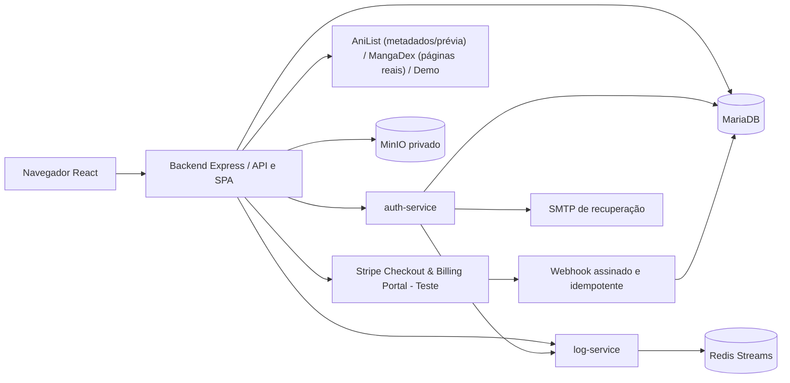

# Documentação técnica — MangaCloud

Atualizado em 13/11/2026. O MangaCloud permite descobrir obras, organizar estantes privadas e ler capítulos pelas fontes configuradas. Esta documentação descreve a arquitetura vigente; histórico de evolução e relatórios de execução estão em [status](docs/STATUS_IMPLEMENTACAO_MANGACLOUD.md) e [evidências da Atividade 11](docs/atividade-11/README.md).

A documentação da entrega anterior foi preservada integralmente como [registro histórico da P1](docs/historico/DOCUMENTACAO_P1.md).

## Serviços e comunicação

| Caminho | Responsabilidade |
| --- | --- |
| `frontend/src/pages` | Landing, catálogo, estantes, obra, leitor, perfil (`Profile.tsx`), planos (`Plans.tsx`), administração (`Admin.tsx`) e ajuda/referência (`Account.tsx`) |
| `frontend/src/hooks` | Sessão, carregamento, paginação e progresso de leitura |
| `backend/src/app.ts` | Montagem da API, headers, erros, Swagger e entrega da SPA |
| `backend/src/routes` | Autenticação/proxy, estantes, leitura, perfil, cobrança (`billing.ts`) e administração (`admin.ts`) |
| `backend/src/providers` | Fontes AniList (`anilistProvider.ts`), MangaDex (`mangadexProvider.ts`) e Demo (`demoProvider.ts`), capítulos canônicos e manifesto |
| `backend/src/services` | Regras de biblioteca, storage MinIO, proxy de capas MangaDex e métricas SaaS administrativas (`adminMetrics.ts`) |
| `auth-service/src` | Cadastro, login, recuperação de senha e gestão de papéis |
| `log-service/src` | Recepção de eventos internos e persistência em Redis Streams |

O backend serve o frontend compilado e a API no mesmo endereço. A porta local prevista é `8224:3001`. A infraestrutura existente será revisada na etapa final de publicação; aliases e nomes físicos de rede/containers ainda preservam a instalação anterior.

## Dados e propriedade

O banco mantém usuários, estantes, itens, metadados de capas personalizadas, favoritos, progresso, assinaturas e eventos Stripe. Obras externas são referenciadas por `provider + manga_id`; capítulos por `provider + chapter_id`. O catálogo externo e as páginas não são copiados para tabelas locais.

`estantes` pertence a `usuarios`; `estante_itens` e `estante_capas` pertencem a `estantes`. Consultas e alterações filtram pelo dono autenticado. Terceiros recebem 404, inclusive administradores tentando abrir bibliotecas alheias. Favoritos e progresso também são privados.

O MinIO guarda avatares e capas enviadas pelo usuário em buckets privados. O backend valida tamanho, formato e dimensões, decodifica/reencoda uploads e entrega os arquivos pela API autenticada. Exclusões/substituições usam fila SQL de limpeza compensatória.

As capas do catálogo MangaDex são buscadas pelo servidor e entregues pela mesma origem, com validação e cache limitado em memória. Há restrição ao host/caminho da fonte e nenhuma URL arbitrária de cliente é aceita.

## Autenticação e permissões

- Cadastro público cria `leitor`.
- `leitor`, `curador` e `admin` organizam suas próprias bibliotecas.
- `curador` e `admin` acessam diagnóstico das fontes e totais da fila de limpeza.
- `admin` consulta usuários, altera papéis e visualiza auditoria.
- A API verifica JWT e reconsulta conta/papel no banco; esconder controles na interface não concede ou retira autorização.

Papel e assinatura são independentes. Pro depende de `assinaturas.status='active'` e `acesso_ate > UTC_TIMESTAMP()`. O booleano legado de usuário não autoriza leitura ou progresso.

## Catálogo, leitura e assinatura

AniList, MangaDex e Demo são namespaces explícitos (`CATALOG_PROVIDER`, com `anilist` padrão na visualização inicial):

- **AniList:** fornece catálogo, capas e metadados reais pela API GraphQL pública. Como não hospeda páginas de mangás, o leitor exibe uma **prévia ilustrativa** claramente sinalizada (`ANILIST · PRÉVIA`).
- **MangaDex:** fornece capas via proxy do backend e páginas reais de capítulos disponíveis na fonte (`pt-br` / `en`).
- **Demo:** catálogo sintético identificado para demonstrar o paywall e o controle de limite sem violar termos de APIs externas.

As fontes externas (AniList em prévia ilustrativa e MangaDex com páginas reais) permanecem gratuitas após login. Os limites do plano **Free** no backend (`403 PLAN_REQUIRED`) cobrem: **até 3 estantes pessoais por conta** (`POST /api/estantes`), **as 3 primeiras posições canônicas** por obra/idioma no **Demo** (`GET /api/leitura/demo/:id/manifesto`) e ausência de sincronização automática de página. O plano **Pro (R$ 9,90/mês em Stripe de teste)** libera estantes ilimitadas, todos os capítulos do Demo e salvamento automático de página (`PUT /api/progresso/:provider/:mangaId`, com verificação atômica de revisão `409`).

Checkout, **Billing Portal** (`POST /api/stripe/portal`) e webhook aceitam somente Stripe em teste. A identidade durável de cobrança (`billing_identity`) evita colisão entre contas que reutilizam IDs em bancos distintos. O webhook verifica assinatura HMAC, associação de propriedade e estado atual remoto antes de atualizar `assinaturas` e `usuarios.is_premium`, mantendo sinalização explícita de inadimplência (`past_due`/`unpaid`).

## API, métricas admin e auditoria

A documentação regenerável está em `/api-docs`; o gerador é `backend/scripts/generate-openapi.cjs`. As rotas principais são `/api/estantes`, `/api/favoritos`, `/api/mangas`, `/api/leitura`, `/api/progresso`, `/api/profile`, `/api/assinatura`, `/api/stripe` e `/api/admin`. No painel administrativo (`/admin`), o backend calcula via `adminMetrics.ts` a contagem de usuários por plano (`Free`/`Pro`), assinaturas por status (ativas, inadimplentes, cancelamento agendado, canceladas), **MRR de teste** (`assinaturasAtivas × 990` centavos) e últimos eventos do `log-service`.

Eventos registram autor, horário, ação, recurso e resultado. A auditoria inclui estantes, limite Free atingido (`estante.limite_atingido`), itens, capas, favoritos, leitura, progresso, assinaturas, abertura do Billing Portal (`assinatura.portal_aberto`), falha de pagamento (`assinatura.pagamento_falhou`), renovação e mudança de papéis. O transporte entre serviços exige token interno; a consulta pela aplicação exige papel `admin`.

## Banco, configuração e operação

O runner de migrations preserva checksums e locks. A versão 002 cria o domínio atual, e a 004 adiciona a identidade de cobrança. O caminho de atualização considera bases legadas. Seed é um comando separado e idempotente, com proteção de contas QA e preservação das estantes editadas. Arquivos SQL aplicados devem permanecer imutáveis; mudanças futuras usam outra migration.

O modelo de ambiente vigente é [.env.example](.env.example). Nunca versionar segredos. A configuração existente e o banco principal foram preservados durante o QA. Publicação exige alvo de banco revisado, backup, migrations, rebuild e conferência da mesma stack, subdomínio e limite de 1 GB por container.

`/health` fornece liveness; `/ready` verifica conectividade/schema das estantes. Healthchecks de autenticação, Redis e MinIO estão no Compose. O plano de publicação está em [operação](docs/OPERACAO_MANGACLOUD.md), reservado à última etapa.

## Verificação

Os testes ficam em [tests/qa](tests/qa/README.md), e os executores em [scripts/qa](scripts/qa/README.md). Recursos de integração são exclusivos e descartáveis. Testes simulados e chamadas externas reais têm resultados identificados separadamente.

- [Estado da implementação e histórico de etapas](docs/STATUS_IMPLEMENTACAO_MANGACLOUD.md).
- [Capas MangaDex e leitura real (12/11)](docs/QA_CAPAS_MANGADEX.md).
- [Assinatura de teste e limites da prova inicial (12/11)](docs/QA_ASSINATURA_MANGACLOUD.md).
- [Evidências — Atividade 10](docs/atividade-10/README.md) e [Evidências — Atividade 11](docs/atividade-11/README.md).
- [Rascunho da entrega pública (Atividade 10)](docs/ENTREGA_ATIVIDADE_10_RASCUNHO.md).

Prints locais e builds comprovam os cenários executados localmente. As evidências em ambiente público (subdomínio real e stack Portainer) e as capturas web do Stripe Dashboard permanecem pendentes até a etapa final autorizada pelo usuário.
