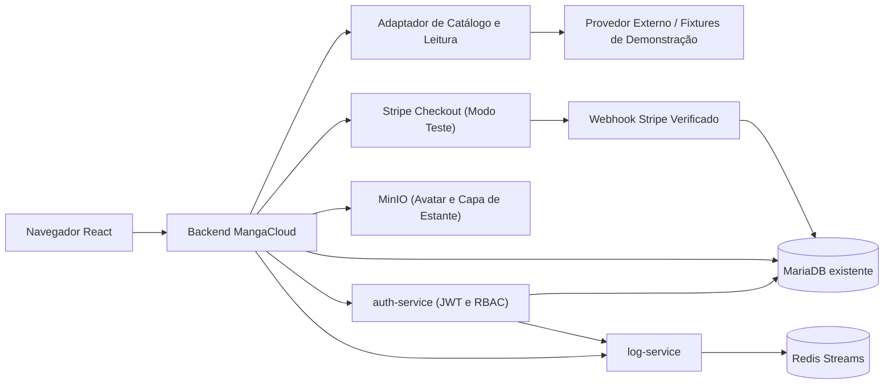

# 📚 MangaCloud — Biblioteca Pessoal e Leitor Web de Mangás e HQs

**Para retomar o desenvolvimento:** [roteiro da última sessão](docs/ROTEIRO_CONTINUIDADE_MANGACLOUD.md), com decisões, resultados e pendências atuais. Publicação/Portainer ficam para a última etapa por decisão do usuário.

**MangaCloud permite que leitores descubram obras, organizem estantes pessoais com capas personalizadas e leiam capítulos em um leitor web limpo com progresso sincronizado.**

Desenvolvido para a disciplina de Introdução à Computação em Nuvem (ISW055), lecionada pelo professor **[@siriani](https://github.com/siriani)** ([github.com/siriani](https://github.com/siriani)).

---

## 1. Nome e Frase

**MangaCloud** — Plataforma SaaS de descoberta, organização de estantes pessoais e leitura online de mangás e quadrinhos que conecta catálogos externos a um leitor web sem anúncios intrusivos, com controle de progresso por página.

---

## 2. A Dor

- **Quem sofre:** Leitores frequentes de mangás, manhwas e HQs digitais (estudantes e jovens adultos que acompanham de 5 a 20 obras simultaneamente no celular e no computador).
- **Quando acontece:** Sempre que o leitor tenta retomar uma obra após alguns dias e não lembra em qual capítulo ou página parou, quando alterna entre o navegador do celular e o PC, ou quando tenta ler um capítulo novo e enfrenta dezenas de redirecionamentos, pop-ups maliciosos e páginas quebradas em sites informais.
- **Quanto custa hoje (tempo, dinheiro e risco — hipótese de negócio):**
  - **Tempo perdido:** Entre 10 e 20 minutos por sessão procurando em qual capítulo/página parou, reabrindo abas perdidas e fechando janelas de propaganda antes de conseguir ler.
  - **Dinheiro mal aproveitado:** Leitores que compram capítulos avulsos em múltiplos aplicativos baseados em "moedas/tintas" acabam gastando valores elevados por mês sem ter uma biblioteca unificada, ou pagam assinaturas fragmentadas que cobrem apenas uma editora específica.
  - **Risco de segurança e perda de dados:** Sites agregadores informais expõem o usuário a anúncios maliciosos (*malvertising* e *phishing*) e saem do ar sem aviso, fazendo o leitor perder toda a sua lista de leitura e histórico de capítulos lidos.
- **Como essa pessoa resolve hoje:** Mantém dezenas de abas abertas no navegador do celular, anota números de capítulos manualmente no Bloco de Notas/planilhas ou usa rastreadores externos que apenas catalogam títulos, mas não oferecem leitura integrada nem salvam a página exata em que o usuário parou.

---

## 3. Persona

*(Persona fictícia e ilustrativa para orientação do produto)*

- **Nome e idade:** Lucas Ferreira, 22 anos.
- **Rotina:** Estudante universitário e estagiário de TI que lê mangás diariamente no celular durante o trajeto de transporte público (40 minutos cada trecho) e continua a leitura no notebook à noite em casa.
- **O que ele tenta fazer:** Manter suas obras separadas em estantes temáticas (*"Lendo no Ônibus"*, *"Shounen de Fim de Semana"*, *"Pausados"*), descobrir novos títulos filtrados por gênero e idioma (`pt-br` ou `en`), e continuar a leitura exatamente da página onde parou quando troca do celular para o notebook.
- **O que atrapalha:** As abas do celular recarregam ou fecham sozinhas, fazendo-o esquecer se parou no capítulo 42 ou 47; quando abre no notebook, seu histórico não está sincronizado; e a experiência nos sites comuns é poluída por banners que cobrem os balões de fala e dificultam a leitura em telas móveis.

---

## 4. Concorrentes e Alternativas

| Alternativa Atual | Utilidade hoje | O que faz mal (Limitações para a Persona) |
| ----------------- | -------------- | ----------------------------------------- |
| **1. Sites agregadores informais + Abas abertas no navegador** | Acesso rápido sem cadastro inicial no navegador. | Exibem pop-ups e redirecionamentos agressivos, não sincronizam histórico entre celular e PC, e perdem o progresso do leitor sempre que o cache limpa ou o domínio sai do ar. |
| **2. Planilhas / Bloco de Notas + Rastreadores apenas de catálogo (MyAnimeList / AniList)** | Permitem listar obras acompanhadas e dar notas. | Não possuem leitor integrado (*Web Reader*), exigem atualização manual a cada capítulo lido e não guardam a página exata dentro do capítulo nem permitem estantes privadas com upload de capa própria no mesmo ambiente de leitura. |
| **3. Apps de capítulos pagos por moeda (Pay-per-chapter) ou exclusivos de uma única editora** | Aplicativos estáveis e livres de pop-ups maliciosos. | Cobram por capítulo desbloqueado individualmente (tornando a leitura contínua cara para quem lê várias séries) ou restringem o catálogo a um único selo editorial, sem organização flexível de biblioteca pessoal. |

---

## 5. Proposta de Valor

**Para leitores recorrentes de mangás e HQs, o MangaCloud une catálogo sob demanda, estantes pessoais customizáveis e um leitor web limpo com retomada automática de página em um único lugar, eliminando abas perdidas, anúncios intrusivos e anotações manuais de progresso.**

---

## 6. Modelo de Receita com Stripe

*(Modelo comercial proposto como hipótese de negócio da disciplina; a integração aceita somente Stripe em **modo de teste**, habilitado explicitamente por configuração, utilizando conteúdo sintético/demonstrativo autorizado para validação do paywall, enquanto a contratação/licenciamento de fonte comercial para produção permanece como etapa de negócio separada).*

A monetização do SaaS ocorre por **assinatura mensal recorrente via Stripe Checkout + Webhooks**, dividindo a experiência do papel `leitor` em dois planos:

| Recurso | Plano Leitor Free (R$ 0/mês) | Plano Leitor Pro — R$ 9,90/mês *(hipótese de preço)* |
| ------- | ---------------------------- | ----------------------------------------------------- |
| **Navegação no catálogo, busca, filtros por gênero/tags e sinopse** | ✅ Ilimitado | ✅ Ilimitado |
| **Criação de estantes pessoais (CRUD completo) + upload de capa personalizada (MinIO)** | ✅ Incluso | ✅ Incluso |
| **Marcação de favoritos e visualização da lista de capítulos** | ✅ Incluso | ✅ Incluso |
| **Acesso ao Web Reader (leitura de páginas dos capítulos)** | 🔒 **No Demo: até as 3 primeiras posições canônicas por obra/idioma** | 🌟 **Acesso completo aos capítulos do Demo** |
| **Salvamento automático e sincronização de progresso (capítulo + página exata)** | ❌ Não incluso | 🌟 **Sincronização automática de página entre dispositivos** |

**Leitura real:** o catálogo MangaDex não recebe esse paywall. Todos os capítulos disponíveis e permitidos na fonte podem ser lidos após autenticação, sem assinatura. O comparativo de desbloqueio abaixo refere-se somente às fixtures Demo.

- **O que o Plano Free limita (Demo):** Permite explorar todo o catálogo, organizar estantes pessoais com capas próprias, favoritar obras e experimentar o leitor nas **3 primeiras posições canônicas** de cada obra/idioma do Demo. Ao tentar abrir o 4º capítulo em diante, o backend bloqueia a entrega do manifesto de páginas (`403 PLAN_REQUIRED`) e apresenta o convite de assinatura.
- **Por que o leitor pagaria o Plano Pro (hipótese de R$ 9,90/mês):** Leitores assíduos acompanham obras longas (dezenas ou centenas de capítulos) em mais de um dispositivo e valorizam continuar qualquer série além do 3º capítulo sem interrupções, com retomada automática na página exata em que pararam.

---

## 7. Métricas de Sucesso

O acompanhamento proposto usa os cinco indicadores abaixo. Não há resultado comercial medido; transações simuladas ou de teste não representam receita real:

1. **Ativação de Biblioteca:** Proporção de novos usuários cadastrados (`leitor`) que criam pelo menos 1 estante pessoal ou adicionam sua primeira obra favorita e abrem ao menos 1 capítulo no leitor.
2. **Taxa de Conversão no Paywall (Free → Pro):** Percentual de leitores que atingem o bloqueio do 4º capítulo (`leitura.bloqueada`) e concluem a assinatura no Stripe Checkout (`assinatura.atualizada`).
3. **Assinantes Pro Ativos:** Total de usuários com assinatura vigente e período de acesso válido confirmado via webhook do Stripe.
4. **MRR (*Monthly Recurring Revenue*):** Receita recorrente mensal calculada pelo número de assinaturas Pro ativas × valor mensal do plano (R$ 9,90 na hipótese base).
5. **Retenção Mensal e Engajamento de Leitura:** Proporção de assinantes que renovam a assinatura no ciclo seguinte e frequência semanal de atualização de progresso (`progresso.atualizado`).

---

## 8. Lean Canvas

| Bloco | Definição no MangaCloud (Hipótese de Produto) |
| ----- | --------------------------------------------- |
| **1. Problema** | 1. Leitores perdem em qual capítulo e página pararam ao alternar entre celular e computador.<br>2. Sites agregadores informais prejudicam a leitura com pop-ups intrusivos, páginas quebradas e perda de histórico.<br>3. Rastreadores de lista (como planilhas ou catálogos avulsos) são separados do leitor e exigem anotação manual. |
| **2. Segmentos de Clientes** | **Público principal:** Estudantes e jovens adultos que leem mangás/HQs semanalmente em mais de um dispositivo.<br>**Early Adopters:** Leitores que já tentam organizar listas manualmente no celular/PC e buscam uma estante integrada a um leitor limpo. |
| **3. Proposta Única de Valor** | Descubra obras, organize estantes pessoais com capas próprias e leia em um Web Reader limpo que lembra exatamente a página onde você parou. |
| **4. Solução** | 1. **Estantes Pessoais com Capas (CRUD + MinIO):** Organização privada de obras com upload de capa personalizada.<br>2. **Web Reader com Gatekeeper no Servidor:** Leitura fluida dos 3 capítulos iniciais no Free e desbloqueio completo no Pro validado no backend.<br>3. **Progresso Sincronizado por Página:** Gravação automática e versionada do capítulo e página atual para assinantes Pro. |
| **5. Canais** | Comunidades de leitores de mangás/quadrinhos no Discord e Reddit, perfis de recomendações no TikTok/Instagram e compartilhamento direto por usuários da plataforma. |
| **6. Fontes de Receita** | Assinatura mensal **MangaCloud Pro** via **Stripe** (hipótese de **R$ 9,90/mês** para leitura completa de capítulos autorizados e sincronização automática de página; plano Free gratuito com estantes e até 3 capítulos iniciais por obra). |
| **7. Estrutura de Custos** | Infraestrutura em nuvem (VM Proxmox + Docker Compose com Node.js/TypeScript, MariaDB, Redis e MinIO), armazenamento de objetos (avatares e capas), taxas de transação do Stripe e eventual licenciamento comercial de conteúdo. |
| **8. Métricas-Chave** | Cadastros totais, taxa de ativação (1ª estante/leitura), bloqueios de paywall vs. conversões, total de assinantes Pro ativos, **MRR** e taxa de retenção/cancelamento (*churn*). |
| **9. Vantagem Injusta** | Ainda não validada. Acesso a leitores da comunidade acadêmica para feedback é uma hipótese a explorar; arquitetura e API pública, por si só, são copiáveis. |

---

## 9. Mapa de Reaproveitamento da Arquitetura

Toda a infraestrutura construída ao longo da disciplina (**mesma stack no Portainer, mesmos containers, limites de memória de 1 GB por container e mesmo subdomínio**) é reaproveitada diretamente no **MangaCloud**:

| Peça do Projeto Atual | O que vira no SaaS | No MangaCloud |
| --------------------- | ------------------ | ------------- |
| **Catálogo externo anterior** | Recurso de descoberta e leitura sob demanda | **Adaptador de Catálogo e Leitura (`providers`):** busca paginada de obras, tags/gêneros, detalhes, lista de capítulos por idioma e manifesto de páginas autorizado no backend (sem armazenar capítulos no banco nem no MinIO). |
| **Favoritos e Comentários** | Recurso principal do domínio (CRUD + Isolamento) | **Estantes Pessoais (`estantes`, `estante_itens`), Favoritos (`favoritos_manga`) e Progresso (`progresso_leitura`):** CRUD completo das próprias estantes com isolamento estrito por `usuario_id`. |
| **Microsserviço de login (`auth-service`) + RBAC** | Autenticação JWT e 3 papéis do negócio | **Papéis `leitor`, `curador` e `admin`:** cadastro público gera `leitor`; `curador` acessa diagnóstico de integração/cobertura do provedor; `admin` gerencia papéis e auditoria (separados do plano `Free`/`Pro`). |
| **Logs e auditoria (`log-service` + Redis)** | Eventos de negócio e trilha de segurança | Eventos estruturados: `estante.criada`, `estante.editada`, `estante.excluida`, `estante.item_adicionado`, `estante.item_removido`, `estante.capa_enviada`, `estante.capa_removida`, `favorito.adicionado`, `favorito.removido`, `leitura.liberada`, `leitura.bloqueada`, `progresso.atualizado`, `assinatura.atualizada` e `usuario.papel_alterado`. |
| **Upload e perfil (`MinIO` Object Storage)** | Arquivos privados do domínio | **Capas Personalizadas de Estante (`estante_capas`) + Avatares de Perfil:** bucket privado para capas das estantes com validação real de imagem e acesso restrito ao dono, além do bucket de foto de perfil. |
| **Plano Premium (`Stripe` Checkout + Webhook)** | Assinatura SaaS e Gatekeeper de Leitura | **Assinatura Leitor Pro (`assinaturas`, `stripe_eventos`):** Stripe Checkout em modo de teste + Webhook idempotente controlando o ciclo da assinatura que libera leitura além do 3º capítulo canônico e salvamento automático de página. |
| **Swagger / OpenAPI, Docker e Observabilidade** | Contratos da API e operação contínua | Documentação OpenAPI (`/api-docs`) atualizada com contratos de mangás, manifesto de leitura, estantes, capas, progresso, curadoria e erros padronizados (`400`, `401`, `403 PLAN_REQUIRED`, `404`, `409`, `413`, `415`, `502/503/504`). |

---

## 10. Arquitetura e Fronteiras do Sistema



### Modo Demonstrativo e Restrições de Provedor Externo

- **Gatekeeper Server-Side:** O frontend nunca decide se um capítulo pode ser lido. Toda requisição de leitura passa pelo serviço central de autorização no backend, que verifica a sessão JWT, o vínculo do capítulo, a posição canônica no Demo (as três primeiras posições liberadas no Free; `1, 2, 2.5` são distintas) e, quando necessário, a assinatura vigente no banco antes de retornar o manifesto de páginas. Em caso de bloqueio (`403 PLAN_REQUIRED`), nenhuma URL ou hash de imagem é trafegado na resposta.
- **Conformidade com Termos de API Externa:** A documentação pública do MangaDex restringe a venda direta de acesso aos dados fornecidos pela sua API. Por isso, a arquitetura do MangaCloud desacopla o provedor por meio de adaptadores (`CATALOG_PROVIDER`) e executa a demonstração do paywall e do ciclo de assinatura Stripe (em modo de teste) sobre **fixtures determinísticas de conteúdo sintético/demonstrativo autorizado**, mantendo qualquer integração técnica com API pública separada de cobrança comercial enquanto uma fonte licenciada não for contratada.


## 11. Execução e estado da entrega

**Endereço local configurado:** `http://localhost:8224`. O endereço público existente deve ser informado após confirmação/redeploy na mesma stack; esta alteração não afirma implantação pública.

A aplicação implementa landing, cadastro/login, estantes/itens, capas privadas, favoritos, catálogo por fonte, leitor paginado, histórico Pro, perfil/avatar, curadoria, administração e auditoria. Dados externos não viram catálogo no banco. Capas MangaDex são entregues pelo backend com cache temporário em memória; catálogo desktop/mobile, obra, estante e leitura real passaram no Chrome com DNS temporário de QA em 12/11 ([evidências](docs/QA_CAPAS_MANGADEX.md)). Pro é calculado por assinatura vigente, nunca pelo booleano legado.

Checkout/pagamento/webhook externo em Stripe teste, Pro/retomada e gestão da renovação pela interface foram aprovados em 12/11. O cancelamento agenda o fim do período pago; a biblioteca e o histórico são preservados. A nova migration `004_identidade_cobranca.sql` cria uma identidade estável de cobrança por conta e foi aplicada somente no banco descartável de QA. [Resultados e limites da assinatura](docs/QA_ASSINATURA_MANGACLOUD.md).

A [revisão final local](docs/QA_REVISAO_FINAL_MANGACLOUD.md) comprovou esse percurso em uma única conta com leitura MangaDex, fim automático do período e renovação recusada via Test Clocks. O leitor foi corrigido para salvar ao sair e manter a posição no retry; listas com 101 registros foram verificadas. Imagens atualizadas foram construídas e verificadas com Node 22, sem redeploy.

Estado da continuidade e pendências: [implementação](docs/STATUS_IMPLEMENTACAO_MANGACLOUD.md), [resultados de QA e prints locais](docs/QA_IMPLEMENTACAO_MANGACLOUD.md) e [rascunho da entrega pública](docs/ENTREGA_ATIVIDADE_10_RASCUNHO.md).

### Preparação local

**Para abrir e explorar no computador:** execute `npm start` na raiz (Node.js 22+ e Docker/Compose) e acesse http://localhost:8224. O ambiente usa banco, uploads e Redis locais próprios, sem ler o `.env` principal ou alterar a stack existente. `npm stop` preserva os dados. [Guia de execução, conta admin local e comandos](docs/EXECUCAO_LOCAL_MANGACLOUD.md).

As imagens usam Node 22; a suíte local também foi executada com Node 24. Preserve as versões dos lockfiles ao instalar.

1. Instale dependências com `npm ci` em `backend`, `frontend`, `auth-service` e `log-service`.
2. Configure o ambiente conforme `.env.example`, preservando o `.env` existente. Escolha explicitamente um banco de desenvolvimento; não execute os comandos de migração no banco principal sem revisar o alvo.
3. No ambiente de desenvolvimento escolhido: `npm --prefix backend run db:migrate` e `npm --prefix backend run db:seed`.
4. Inicie os serviços configurados com `npm --prefix auth-service run dev`, `npm --prefix log-service run dev` e `npm --prefix backend run dev`. Para frontend com hot reload, use `npm --prefix frontend run dev`; para a interface servida pelo backend, faça `npm --prefix frontend run build`.
5. O cadastro público cria leitor. Admin legado é preservado; provisionamento QA usa emails dedicados configurados no ambiente, sem trocar senha/papel de contas existentes. Segredos precisam permanecer estáveis entre execuções do seed para reconhecer as contas QA assinadas.

### Testes reproduzíveis

```bash
node tests/qa/phase1-providers.review.cjs
node tests/qa/phase2-seed.review.cjs
node tests/qa/mangadex-covers.review.cjs
python3 scripts/qa/run-phase2-mariadb.review.py
python3 scripts/qa/run-phase2-mariadb.review.py --api
python3 scripts/qa/run-phase2-mariadb.review.py --browser
```

Os executores criam instâncias exclusivas de QA, em portas aleatórias de loopback, usando imagens locais `mariadb:11.8`, `elestio/minio:latest` e `redis:7-alpine`. Removem somente os recursos que criaram. O teste de navegador requer Chrome local ou Chromium do Playwright. As suítes HTTP usam MariaDB, MinIO e Redis reais; Stripe e indisponibilidade da fonte externa são simulados explicitamente, sem cobranças ou alegação de leitura real aprovada.

O modo opcional `python3 scripts/qa/run-phase2-mariadb.review.py --stripe-live` usa chave/preço de teste do `.env`, Chrome e Stripe CLI para criar/pagar checkout de teste e receber webhooks reais, conferindo Pro/retomada e gestão. Encerra a assinatura QA, remove seu cliente remoto e o listener ao terminar. Não altera o `.env` nem o banco principal. É uma execução com objetos externos de teste, além da suíte simulada padrão.

Para repetir o percurso em uma conta com MangaDex e os ciclos de renovação: `python3 scripts/qa/run-phase2-mariadb.review.py --stripe-live --stripe-clocks --mangadex-live --public-dns`. O modo adicional cria/remove Test Clock próprio e usa resolução temporária apenas no QA.

Para consultar a integração real separadamente: `npm --prefix backend run verify:phase1 -- --require-live`. Falta de conectividade mantém a prova de leitura **pendente** e o comando retorna falha, sem mudar para Demo.

### Build, API e implantação

- `npm run build` em cada um dos quatro serviços/projetos executa a compilação apropriada; o frontend inclui typecheck.
- Swagger: `/api-docs`. Contratos regeneráveis com `npm --prefix backend run docs:generate`.
- `/health`: liveness; `/ready`: conectividade/schema das estantes. Uploads usam buckets privados e são acessados via API autenticada.
- `STRIPE_DEMO_ENABLED=false` por padrão. Para demonstração externa de pagamento, configurar preço e chaves **de teste**; nunca usar chaves live.
- O Dockerfile executa JavaScript compilado. `npm run db:migrate` e `npm run db:seed` também funcionam na imagem em `NODE_ENV=production`, sem dependência de tsx global.
- Antes do redeploy, backup e revisão do banco/variáveis, execução das migrations no alvo correto, preservação de volumes e confirmação do commit. Plano operacional em [operação MangaCloud](docs/OPERACAO_MANGACLOUD.md).

### Limites atuais

- O DNS normal da rede consultada limita o acesso ao MangaDex. A prova real com capas e páginas passou usando resolução temporária exclusiva de QA, que não altera o DNS da máquina nem resolve o acesso cotidiano dessa rede.
- Não há fonte comercial licenciada definida. Preço Pro de R$ 9,90 é uma hipótese didática, não configuração aprovada de cobrança real.
- Não foram publicados issue de entrega, prints do Portainer ou deploy público por esta implementação. Evidências locais não substituem essas exigências da Atividade 10.
