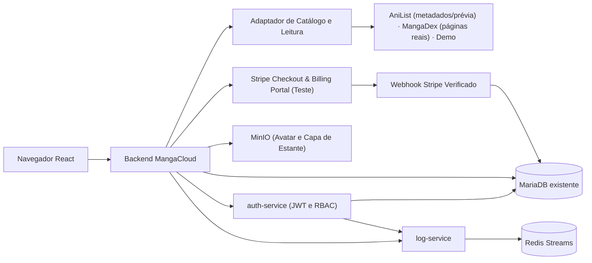

# 📚 MangaCloud — Biblioteca Pessoal e Leitor Web de Mangás e HQs

**MangaCloud permite que leitores descubram obras em catálogos externos, organizem estantes pessoais com capas personalizadas e leiam capítulos em um leitor web limpo com progresso sincronizado.**

Desenvolvido para a disciplina de Introdução à Computação em Nuvem (ISW055), lecionada pelo professor **[@siriani](https://github.com/siriani)** ([github.com/siriani](https://github.com/siriani)).

### Documentação e evidências das atividades

- **[Atividade 10 — Seu negócio no ar](docs/atividade-10/README.md)** (`docs/atividade-10`)
- **[Atividade 11 — SaaS completo com Stripe](docs/atividade-11/README.md)** (`docs/atividade-11`)

---

## 1. Nome e Frase

**MangaCloud** — Plataforma SaaS de descoberta, organização de estantes pessoais e leitura online de mangás e quadrinhos que conecta catálogos externos a um leitor web sem anúncios intrusivos, com controle de progresso por página.

---

## 2. A Dor

- **Quem sofre:** Leitores frequentes de mangás, manhwas e HQs digitais (estudantes e jovens adultos que acompanham de 5 a 20 obras simultaneamente no celular e no computador).
- **Quando acontece:** Sempre que o leitor tenta retomar uma obra após alguns dias e não lembra em qual capítulo ou página parou, quando alterna entre o navegador do celular e o PC, ou quando tenta ler um capítulo novo e enfrenta dezenas de redirecionamentos, pop-ups maliciosos e páginas quebradas em sites informais.
- **Quanto custa hoje (tempo, dinheiro e risco — hipótese de negócio):**
  - **Tempo perdido:** Entre 10 e 20 minutos por sessão procurando em qual capítulo/página parou, reabrindo abas perdidas e fechando janelas de propaganda antes de conseguir ler.
  - **Dinheiro mal aproveitado:** Leitores que compram capítulos avulsos em múltiplos aplicativos baseados em "moedas/tintas" acabam gastando valores elevados por mês sem ter uma biblioteca unificada, ou pagam assinaturas fragmentadas que cobrem apenas uma editora específica.
  - **Risco de segurança e perda de dados:** Sites agregadores informais expõem o usuário a anúncios maliciosos (*malvertising* e *phishing*) e saem do ar sem aviso, fazendo o leitor perder toda a sua lista de leitura e histórico de capítulos lidos.
- **Como essa pessoa resolve hoje:** Mantém dezenas de abas abertas no navegador do celular, anota números de capítulos manualmente no Bloco de Notas/planilhas ou usa rastreadores externos que apenas catalogam títulos, mas não oferecem leitura integrada nem salvam a página exata em que o usuário parou.

---

## 3. Persona

*(Persona fictícia e ilustrativa para orientação do produto)*

- **Nome e idade:** Lucas Ferreira, 22 anos.
- **Rotina:** Estudante universitário e estagiário de TI que lê mangás diariamente no celular durante o trajeto de transporte público (40 minutos cada trecho) e continua a leitura no notebook à noite em casa.
- **O que ele tenta fazer:** Manter suas obras separadas em estantes temáticas (*"Lendo no Ônibus"*, *"Shounen de Fim de Semana"*, *"Pausados"*), descobrir novos títulos filtrados por gênero e idioma (`pt-br` ou `en`), e continuar a leitura exatamente da página onde parou quando troca do celular para o notebook.
- **O que atrapalha:** As abas do celular recarregam ou fecham sozinhas, fazendo-o esquecer se parou no capítulo 42 ou 47; quando abre no notebook, seu histórico não está sincronizado; e a experiência nos sites comuns é poluída por banners que cobrem os balões de fala e dificultam a leitura em telas móveis.

---

## 4. Concorrentes e Alternativas

| Alternativa Atual | Utilidade hoje | O que faz mal (Limitações para a Persona) |
| ----------------- | -------------- | ----------------------------------------- |
| **1. Sites agregadores informais + Abas abertas no navegador** | Acesso rápido sem cadastro inicial no navegador. | Exibem pop-ups e redirecionamentos agressivos, não sincronizam histórico entre celular e PC, e perdem o progresso do leitor sempre que o cache limpa ou o domínio sai do ar. |
| **2. Planilhas / Bloco de Notas + Rastreadores apenas de catálogo (MyAnimeList / AniList)** | Permitem listar obras acompanhadas e dar notas. | Não possuem leitor integrado (*Web Reader*), exigem atualização manual a cada capítulo lido e não guardam a página exata dentro do capítulo nem permitem estantes privadas com upload de capa própria no mesmo ambiente de leitura. |
| **3. Apps de capítulos pagos por moeda (Pay-per-chapter) ou exclusivos de uma única editora** | Aplicativos estáveis e livres de pop-ups maliciosos. | Cobram por capítulo desbloqueado individualmente (tornando a leitura contínua cara para quem lê várias séries) ou restringem o catálogo a um único selo editorial, sem organização flexível de biblioteca pessoal. |

---

## 5. Proposta de Valor

**Para leitores recorrentes de mangás e HQs, o MangaCloud une catálogo sob demanda, estantes pessoais customizáveis e um leitor web limpo com retomada automática de página em um único lugar, eliminando abas perdidas, anúncios intrusivos e anotações manuais de progresso.**

---

## 6. Modelo de Receita com Stripe

*(Modelo comercial proposto como hipótese de negócio da disciplina; a integração aceita somente Stripe em **modo de teste**, habilitado explicitamente por configuração, utilizando conteúdo sintético/demonstrativo autorizado para validação do paywall, enquanto a contratação/licenciamento de fonte comercial para produção permanece como etapa de negócio separada).*

A monetização do SaaS ocorre por **assinatura mensal recorrente via Stripe Checkout + Webhooks**, dividindo a experiência do papel `leitor` em dois planos:

| Recurso | Plano Leitor Free (R$ 0/mês) | Plano Leitor Pro — R$ 9,90/mês *(hipótese de preço)* |
| ------- | ---------------------------- | ----------------------------------------------------- |
| **Navegação no catálogo, busca, filtros por gênero/tags e sinopse** | ✅ Ilimitado | ✅ Ilimitado |
| **Criação de estantes pessoais (CRUD completo) + upload de capa personalizada (MinIO)** | 🔒 **Até 3 estantes pessoais por conta** | 🌟 **Estantes pessoais ilimitadas** |
| **Marcação de favoritos e visualização da lista de capítulos** | ✅ Incluso | ✅ Incluso |
| **Acesso ao Web Reader (leitura e fontes externas)** | 🔒 **No Demo:** até as 3 primeiras posições canônicas por obra/idioma ✅ **AniList:** prévia ilustrativa (sem páginas reais) ✅ **MangaDex:** páginas reais disponíveis na fonte | 🌟 **No Demo:** acesso completo aos capítulos ✅ **AniList / MangaDex:** igual + sincronização |
| **Salvamento automático e sincronização de progresso (capítulo + página exata)** | ❌ Não incluso | 🌟 **Sincronização automática de página entre dispositivos** |

**Regras das fontes, planos e papéis:**
- **AniList:** fornece catálogo, capas e metadados reais pela API pública (os gêneros são traduzidos para português na aplicação, enquanto título e sinopse vêm no idioma original da fonte, em inglês). Como o AniList não hospeda páginas de capítulos, o leitor exibe uma **prévia ilustrativa** identificada (`ANILIST · PRÉVIA`), gratuita após login.
- **MangaDex:** fornece capas (via proxy do backend) e **páginas reais** disponíveis na fonte em `pt-br`/`en`, gratuitas após login e sem paywall.
- **Demo:** conteúdo sintético identificado para demonstrar o paywall no leitor (`403 PLAN_REQUIRED` a partir da 4ª posição canônica).
- **Free vs. Pro:** no **Free**, cada conta pode criar **até 3 estantes pessoais**, ler as **3 primeiras posições canônicas** do Demo e visualizar fontes externas sem sincronização automática de página. No **Pro (R$ 9,90/mês em Stripe de teste)**, as estantes são **ilimitadas**, o catálogo Demo fica liberado integralmente e o progresso de página é sincronizado com controle de revisão (`409`).
- **Papéis e planos são independentes:** o papel de RBAC (`leitor`, `curador`, `admin`) controla acesso administrativo e diagnóstico de fontes, enquanto o plano (`Free` ou `Pro`) depende apenas da assinatura vigente no banco.

- **Limites e desbloqueio no backend (`403 PLAN_REQUIRED`):** A cada requisição em `POST /api/estantes`, `GET /api/leitura/demo/:id/manifesto` e `PUT /api/progresso/:provider/:mangaId`, o backend consulta a assinatura vigente no MariaDB. Ao atingir o limite (ex.: tentativa de criar a 4ª estante ou abrir o 4º capítulo Demo), a API recusa com `403 PLAN_REQUIRED`, informa qual é o limite e orienta a assinar o Plano Pro.
- **Assinatura recorrente, Webhooks e Portal do Cliente:** O checkout usa `mode=subscription` em modo de teste. O plano nunca muda apenas pelo redirecionamento de sucesso: é atualizado exclusivamente via webhook assinado e idempotente (`checkout.session.completed`, `customer.subscription.created`, `customer.subscription.updated`, `customer.subscription.deleted`, `invoice.paid`, `invoice.payment_succeeded`, `invoice.payment_failed`), com aviso de inadimplência (`past_due`/`unpaid`) e gerenciamento de cancelamento/renovação pelo **Billing Portal** (`POST /api/stripe/portal`) conforme a política configurada no painel Stripe.
- **Painel Admin (`admin`):** Exibe contagem de usuários por plano (`Free` e `Pro`), assinaturas por status (ativas, inadimplentes, cancelamento agendado, canceladas), **MRR de teste** (`assinaturas ativas × R$ 9,90`) e últimos eventos da trilha de auditoria.

---

## 7. Métricas de Sucesso

O acompanhamento proposto usa os cinco indicadores abaixo. Não há resultado comercial medido; transações simuladas ou de teste não representam receita real:

1. **Ativação de Biblioteca:** Proporção de novos usuários cadastrados (`leitor`) que criam pelo menos 1 estante pessoal ou adicionam sua primeira obra favorita e abrem ao menos 1 capítulo no leitor.
2. **Taxa de Conversão no Paywall (Free → Pro):** Percentual de leitores que atingem o bloqueio do 4º capítulo (`leitura.bloqueada`) e concluem a assinatura no Stripe Checkout (`assinatura.atualizada`).
3. **Assinantes Pro Ativos:** Total de usuários com assinatura vigente e período de acesso válido confirmado via webhook do Stripe.
4. **MRR (*Monthly Recurring Revenue*):** Receita recorrente mensal calculada pelo número de assinaturas Pro ativas × valor mensal do plano (R$ 9,90 na hipótese base).
5. **Retenção Mensal e Engajamento de Leitura:** Proporção de assinantes que renovam a assinatura no ciclo seguinte e frequência semanal de atualização de progresso (`progresso.atualizado`).

---

## 8. Lean Canvas

| Bloco | Definição no MangaCloud (Hipótese de Produto) |
| ----- | --------------------------------------------- |
| **1. Problema** | 1. Leitores perdem em qual capítulo e página pararam ao alternar entre celular e computador. 2. Sites agregadores informais prejudicam a leitura com pop-ups intrusivos, páginas quebradas e perda de histórico. 3. Rastreadores de lista (como planilhas ou catálogos avulsos) são separados do leitor e exigem anotação manual. |
| **2. Segmentos de Clientes** | **Público principal:** Estudantes e jovens adultos que leem mangás/HQs semanalmente em mais de um dispositivo. **Early Adopters:** Leitores que já tentam organizar listas manualmente no celular/PC e buscam uma estante integrada a um leitor limpo. |
| **3. Proposta Única de Valor** | Descubra obras, organize estantes pessoais com capas próprias e leia em um Web Reader limpo que lembra exatamente a página onde você parou. |
| **4. Solução** | 1. **Estantes Pessoais com Capas (CRUD + MinIO):** Organização privada de obras (até 3 no Free; ilimitadas no Pro) com upload de capa personalizada. 2. **Web Reader e Provedores Explícitos:** Catálogo e metadados AniList (prévia ilustrativa), páginas reais MangaDex e catálogo Demo para validação do gatekeeper no servidor. 3. **Progresso Sincronizado e Billing Portal:** Gravação automática/versionada do capítulo e página para assinantes Pro e autoatendimento pelo Portal Stripe. |
| **5. Canais** | Comunidades de leitores de mangás/quadrinhos no Discord e Reddit, perfis de recomendações no TikTok/Instagram e compartilhamento direto por usuários da plataforma. |
| **6. Fontes de Receita** | Assinatura mensal **MangaCloud Pro** via **Stripe em modo de teste** (hipótese de **R$ 9,90/mês** para estantes ilimitadas, todos os capítulos Demo e sincronização automática de página; plano Free com até 3 estantes e até 3 posições Demo). |
| **7. Estrutura de Custos** | Infraestrutura em nuvem (VM Proxmox + Docker Compose com Node.js/TypeScript, MariaDB, Redis e MinIO), armazenamento de objetos (avatares e capas), taxas de transação do Stripe e eventual licenciamento comercial de conteúdo. |
| **8. Métricas-Chave** | Cadastros totais, taxa de ativação (1ª estante/leitura), bloqueios de paywall vs. conversões, total de assinantes Pro ativos, **MRR** e taxa de retenção/cancelamento (*churn*). |
| **9. Vantagem Injusta** | Ainda não validada. Acesso a leitores da comunidade acadêmica para feedback é uma hipótese a explorar; arquitetura e API pública, por si só, são copiáveis. |

---

## 9. Mapa de Reaproveitamento da Arquitetura

Toda a infraestrutura construída ao longo da disciplina (**mesma stack no Portainer, mesmos containers, limites de memória de 1 GB por container e mesmo subdomínio**) é reaproveitada diretamente no **MangaCloud**:

| Peça do Projeto Atual | O que vira no SaaS | No MangaCloud |
| --------------------- | ------------------ | ------------- |
| **Catálogo externo anterior** | Recurso de descoberta e leitura sob demanda | **Adaptador de Catálogo e Leitura (`providers`):** busca paginada de obras, tags/gêneros, detalhes, lista de capítulos por idioma e manifesto de páginas autorizado no backend (sem armazenar capítulos no banco nem no MinIO). |
| **Favoritos e Comentários** | Recurso principal do domínio (CRUD + Isolamento) | **Estantes Pessoais (`estantes`, `estante_itens`), Favoritos (`favoritos_manga`) e Progresso (`progresso_leitura`):** CRUD completo das próprias estantes com isolamento estrito por `usuario_id`. |
| **Microsserviço de login (`auth-service`) + RBAC** | Autenticação JWT e 3 papéis do negócio | **Papéis `leitor`, `curador` e `admin`:** cadastro público gera `leitor`; `curador` acessa diagnóstico de integração/cobertura do provedor; `admin` gerencia papéis e auditoria (separados do plano `Free`/`Pro`). |
| **Logs e auditoria (`log-service` + Redis)** | Eventos de negócio e trilha de segurança | Eventos estruturados: `estante.criada`, `estante.editada`, `estante.excluida`, `estante.limite_atingido`, `estante.item_adicionado`, `estante.item_removido`, `estante.capa_enviada`, `estante.capa_removida`, `favorito.adicionado`, `favorito.removido`, `leitura.liberada`, `leitura.bloqueada`, `progresso.atualizado`, `assinatura.atualizada`, `assinatura.pagamento_falhou`, `assinatura.portal_aberto` e `usuario.papel_alterado`. |
| **Upload e perfil (`MinIO` Object Storage)** | Arquivos privados do domínio | **Capas Personalizadas de Estante (`estante_capas`) + Avatares de Perfil:** bucket privado para capas das estantes com validação real de imagem e acesso restrito ao dono, além do bucket de foto de perfil. |
| **Plano Premium (`Stripe` Checkout + Billing Portal + Webhook)** | Assinatura SaaS e Gatekeeper de Leitura | **Assinatura Leitor Pro (`assinaturas`, `stripe_eventos`):** Stripe Checkout e Billing Portal em modo de teste + Webhook idempotente controlando estantes ilimitadas, leitura completa do Demo e sincronização automática de página. |
| **Swagger / OpenAPI, Docker e Observabilidade** | Contratos da API e operação contínua | Documentação OpenAPI (`/api-docs`) atualizada com contratos de mangás, manifesto de leitura, estantes, capas, progresso, curadoria e erros padronizados (`400`, `401`, `403 PLAN_REQUIRED`, `404`, `409`, `413`, `415`, `502/503/504`). |

---

## 10. Arquitetura e Fronteiras do Sistema

### Fontes de Catálogo e Gatekeeper Server-Side

- **Separação explícita entre fontes:** O provedor padrão de descoberta é o **AniList**, exibindo capas e metadados reais com leitor claramente identificado como **prévia ilustrativa** (o AniList não distribui páginas de capítulos). O **MangaDex** fornece páginas reais quando disponível na rede, e o **Demo** oferece obras sintéticas para demonstrar o paywall sem violar termos de APIs externas.
- **Gatekeeper Server-Side:** O frontend nunca decide se uma estante adicional ou capítulo Demo pode ser aberto. Toda requisição passa pelo backend, que verifica a sessão JWT e a assinatura vigente no banco antes de liberar criação além da 3ª estante (`POST /api/estantes`) ou capítulos além da 3ª posição canônica do Demo (`1, 2, 2.5` são distintas). Em caso de bloqueio (`403 PLAN_REQUIRED`), nenhuma URL ou hash de imagem é trafegado.

## 11. Execução e documentação das atividades

**Endereço local padrão:** `http://localhost:8224`.

### Execução rápida em ambiente local (`npm start`)

1. Pré-requisitos na máquina: **Node.js 22+** e **Docker com Compose**.
2. A partir da raiz do repositório, execute **`npm start`**. O inicializador constrói as imagens locais e sobe MariaDB, Redis, MinIO, `auth-service`, `log-service` e `backend` (com `frontend` compilado) na porta `8224`.
3. O ambiente local possui volumes próprios isolados do `.env` principal: `npm run check:local` verifica saúde, catálogo Demo, login admin e fonte externa; `npm stop` para os containers preservando os dados; `npm run build:local` reconstrói as imagens.

### Desenvolvimento manual por serviço

Caso deseje rodar os serviços fora do Docker local:

1. Instale dependências com `npm ci` em `backend`, `frontend`, `auth-service` e `log-service`.
2. Configure as variáveis de ambiente com base em `.env.example`.
3. Aplique migrations e seed: `npm --prefix backend run db:migrate && npm --prefix backend run db:seed`.
4. Suba `npm --prefix auth-service run dev`, `npm --prefix log-service run dev`, `npm --prefix backend run dev` e `npm --prefix frontend run dev` (ou `npm --prefix frontend run build` para servir via backend).

### Documentação das atividades

- **[Atividade 10 — Seu negócio no ar](docs/atividade-10/README.md)** (`docs/atividade-10/`): visão do domínio, catálogos AniList (prévia ilustrativa), MangaDex (páginas reais) e Demo, estantes com capa no MinIO, contratos Swagger/OpenAPI, RBAC (`403`), isolamento (`404`) e eventos na auditoria.
- **[Atividade 11 — SaaS completo com Stripe](docs/atividade-11/README.md)** (`docs/atividade-11/`): limite de `3` estantes no Free, Checkout Stripe teste (`4242` · `R$ 9,90/mês`), confirmação via webhook idempotente, Stripe Billing Portal, gerenciamento de renovação/inadimplência e métricas/MRR no Painel Admin.

### API, build e regras atuais

- `npm run build` em cada projeto (`backend`, `auth-service`, `log-service`, `frontend`) compila e valida tipos; `npm --prefix backend run docs:generate` gera os contratos OpenAPI em `/api-docs`.
- `/health` (liveness) e `/ready` (conectividade e schema); `STRIPE_DEMO_ENABLED=false` por padrão até configurar chaves de **teste** do Stripe.
- **Provedores de catálogo:** AniList entrega capas e metadados reais com leitor em **prévia ilustrativa**; MangaDex entrega páginas reais quando acessível na rede; Demo é conteúdo sintético identificado para demonstrar o paywall.
- **Planos e papéis:** plano **Free** limita a **3 estantes pessoais** e **3 posições Demo**; plano **Pro** custa **R$ 9,90/mês** em Stripe modo teste. Papéis (`leitor`, `curador`, `admin`) não se misturam aos planos.
