# Documentação e Evidências — Atividade 10 (Seu negócio no ar)

Pasta organizada com a documentação e as capturas de tela do projeto **MangaCloud** para a **Atividade 10** (disciplina **ISW055**, professor **@siriani**).

- **Repositório:** `https://github.com/Paulo794/Manga-Cloud`
- **Commit base registrado:** `ad96047` (com consolidação local de **13/11/2026**)
- **Data das capturas:** **13/11/2026**
- **Ambiente das capturas:** **Ambiente local isolado** (instância efêmera em loopback com MariaDB `11.8`, MinIO, Redis e container/serviços da aplicação, utilizando exclusivamente contas sintéticas `@mangacloud.demo` e tokens sanitizados no Swagger com `Bearer [token-omitido]`)

> [!IMPORTANT]
> **Natureza das evidências e pendências para publicação:** todas as capturas nesta pasta são **evidências locais** (executadas antes do redeploy público autorizado pelo usuário). Conforme a checklist da Atividade 10, permanecem **pendentes** para a entrega definitiva:
> 1. Captura do **Portainer** mostrando a stack saudável com limite efetivo de **`1 GB`** por container no ambiente alvo;
> 2. Repetição e coleta de capturas equivalentes diretamente no **subdomínio público** (`landing`, listagem do recurso principal, `403` por papel, `404` ao tentar acessar registro alheio, logs no Painel Admin e arquivo privado no MinIO);
> 3. Publicação autorizada da **issue final de entrega** (ainda não criada).

---

## Matriz de Cobertura — Atividade 10

| Requisito da Atividade 10 | Evidência local atual (13/11/2026) | Status no ambiente público / Portainer |
| --- | --- | --- |
| Landing aberta sem login | [`01-landing-sem-login.png`](imagens/01-landing-sem-login.png) | Pendente validar no subdomínio público |
| Listagem do recurso principal (`estantes`) | [`09-estantes-listagem-e-capa-minio.png`](imagens/09-estantes-listagem-e-capa-minio.png) | Pendente validar no subdomínio público |
| Arquivo no MinIO (capa privada sem expor credenciais/URL pública) | [`09-estantes-listagem-e-capa-minio.png`](imagens/09-estantes-listagem-e-capa-minio.png) e [`10-estante-detalhe-capa-minio.png`](imagens/10-estante-detalhe-capa-minio.png) | Pendente validar no ambiente público/MinIO |
| Bloqueio `403` por papel (`leitor` em rota `admin`) | [`11-rbac-403-papel-swagger.png`](imagens/11-rbac-403-papel-swagger.png) | Pendente repetir no subdomínio público |
| Bloqueio `404` ao acessar registro alheio (Conta B → Conta A) | [`12-isolamento-404-registro-alheio-swagger.png`](imagens/12-isolamento-404-registro-alheio-swagger.png) e [`13-isolamento-estante-alheia-ui.png`](imagens/13-isolamento-estante-alheia-ui.png) | Pendente repetir no subdomínio público |
| Eventos de negócio registrados na Auditoria (`/admin`) | [`14-admin-logs-auditoria.png`](imagens/14-admin-logs-auditoria.png) | Pendente validar no subdomínio público |
| Catálogos AniList (prévia ilustrativa), MangaDex (páginas reais) e Demo | [`02`](imagens/02-catalogo-anilist-ao-vivo.png) a [`08`](imagens/08-catalogo-demo.png) | Comprovado localmente (13/11/2026) |
| Documentação Swagger / OpenAPI (`/api-docs`) | [`16-swagger-openapi.png`](imagens/16-swagger-openapi.png) | Disponível após redeploy |
| Stack saudável no Portainer com limite efetivo de `1 GB` | — | **Pendente** (aguardando publicação/Portainer) |

Veja também as evidências financeiras e do portal SaaS na pasta [Atividade 11](../atividade-11/README.md) e o guia de reprodução local no [README principal](../../README.md).

---

## 1. Landing Page, Catálogos Reais e OpenAPI

### Landing Page aberta sem login (ambiente local)
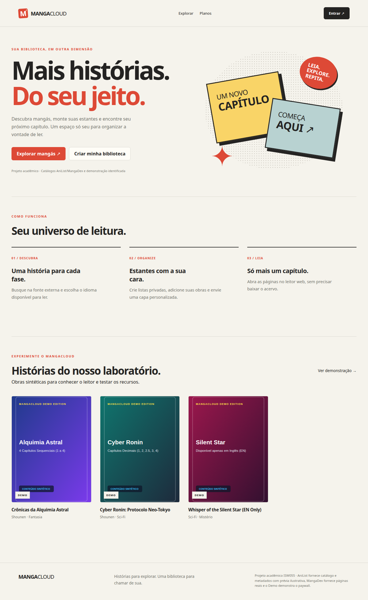

### Catálogo real — AniList (provedor padrão · metadados e capas reais)
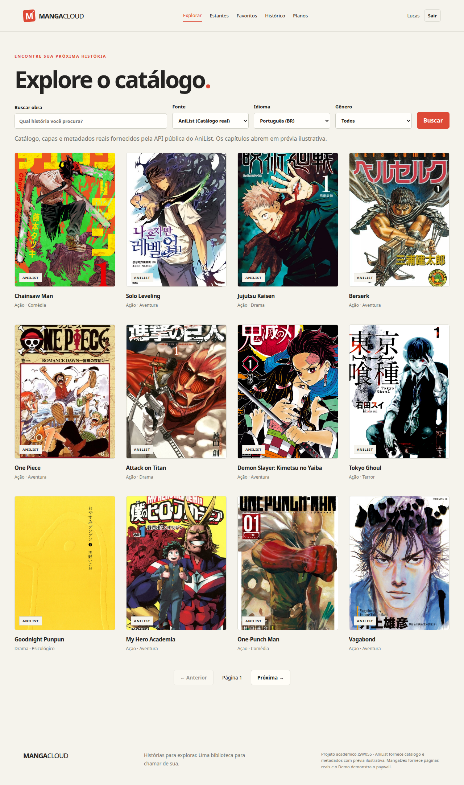

### Detalhe de obra no AniList — identificação explícita de prévia ilustrativa
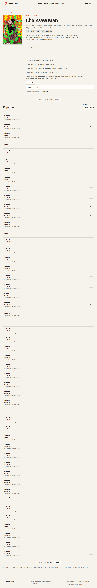

### Leitor Web — AniList (`ANILIST · PRÉVIA` ilustrativa, sem páginas externas de capítulos)
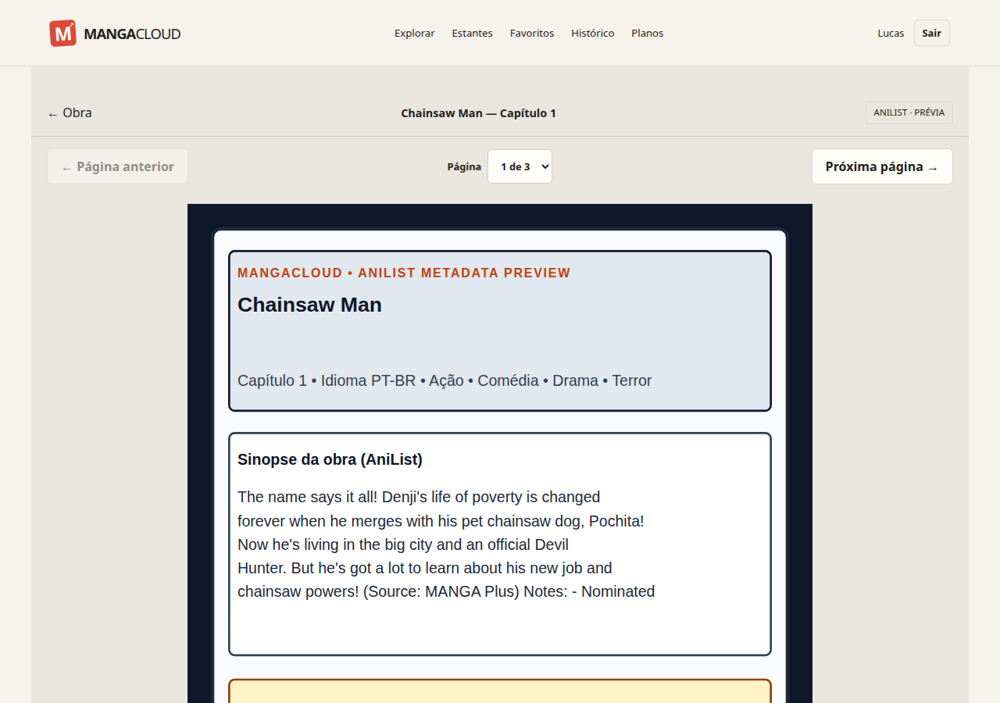

### Catálogo real — MangaDex (capas reais via proxy do backend)
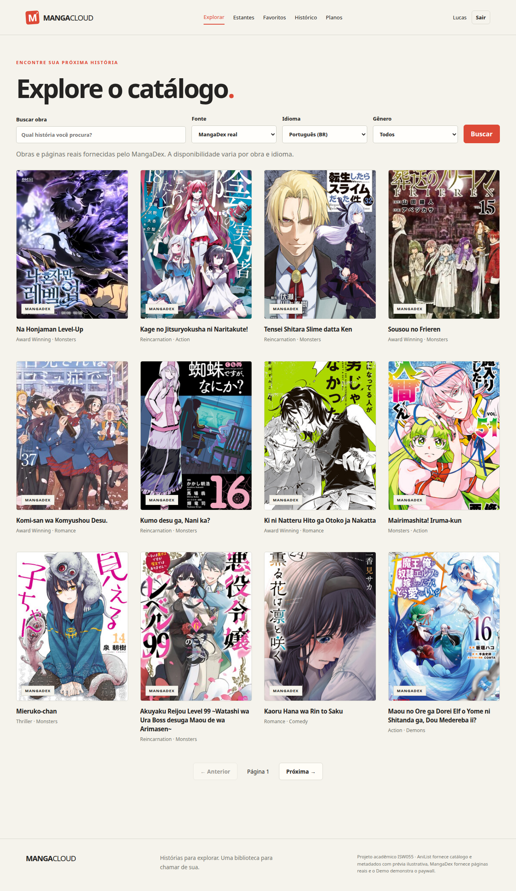

### Detalhe de obra no MangaDex — capítulos disponíveis em PT-BR e créditos dos grupos
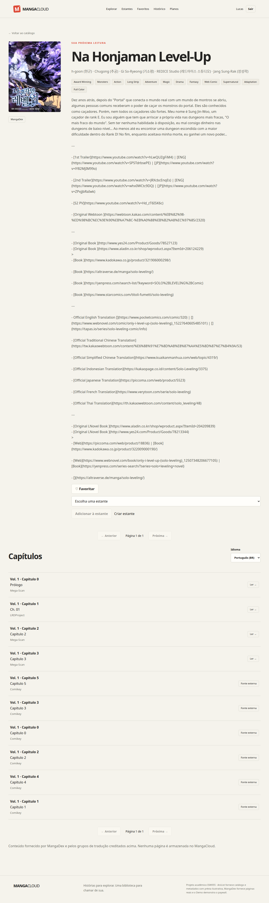

### Leitor Web — MangaDex (página real de capítulo em PT-BR)
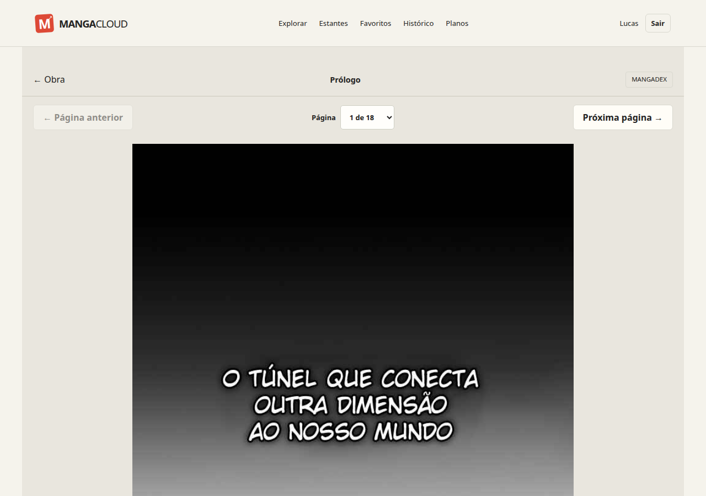

### Catálogo Demo identificado (obras sintéticas para demonstração)
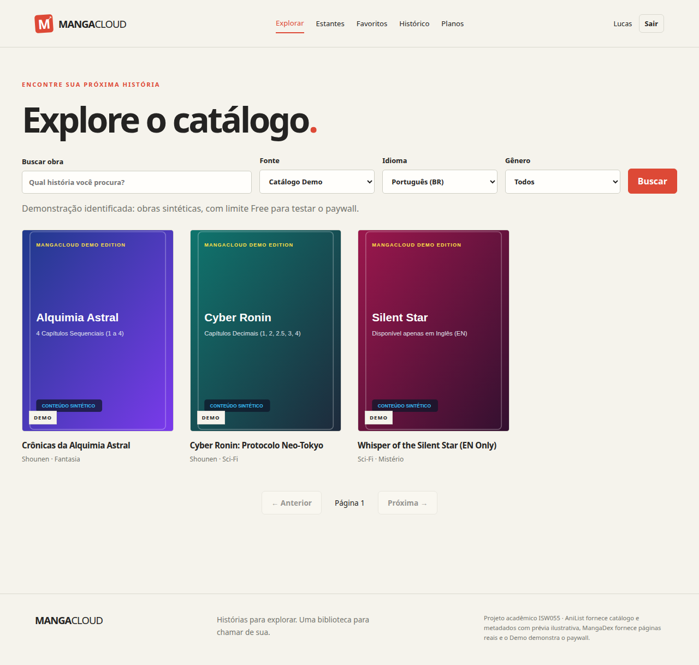

### Swagger / OpenAPI (`/api-docs`)
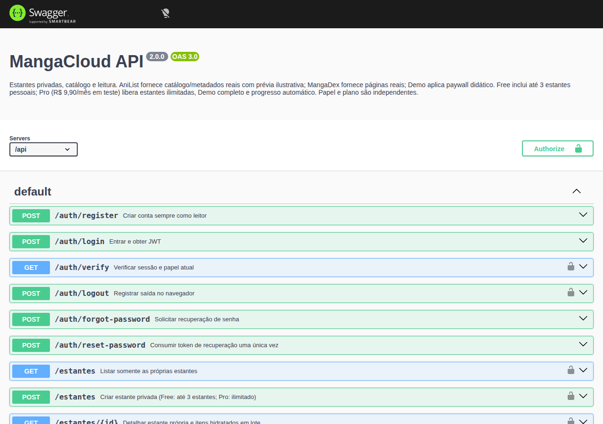

---

## 2. Recurso Principal, MinIO Privado, Segurança e Auditoria

### Listagem do recurso principal — Estantes privadas com capa servida do MinIO
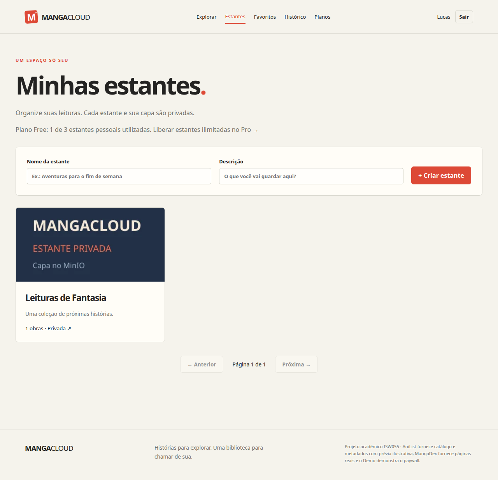

### Detalhe da estante — Upload privado no MinIO e referência adicionada
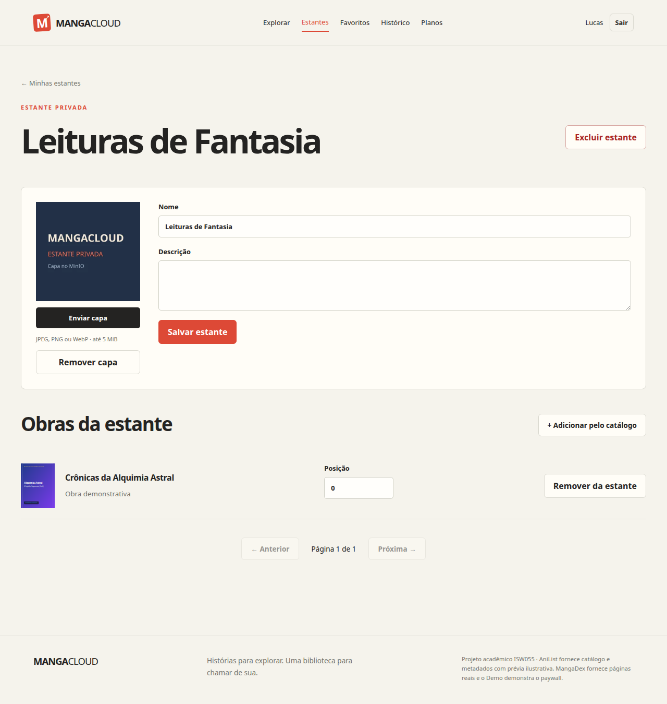

### Controle de acesso por papel (`403 FORBIDDEN` no Swagger)
Conta `leitor` (`lucas.free@mangacloud.demo`) autenticada tentando `GET /api/admin/metricas` no Swagger: bloqueio `403 FORBIDDEN`.
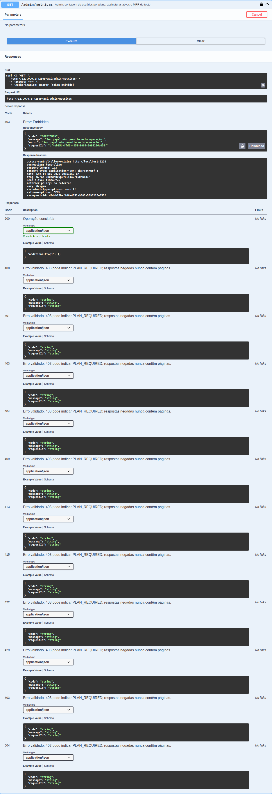

### Isolamento entre contas (`404 NOT_FOUND` na API e na interface)
Conta B (`marina.pro@mangacloud.demo`) tentando acessar a estante privada `1` pertencente à Conta A (`lucas.free@mangacloud.demo`):
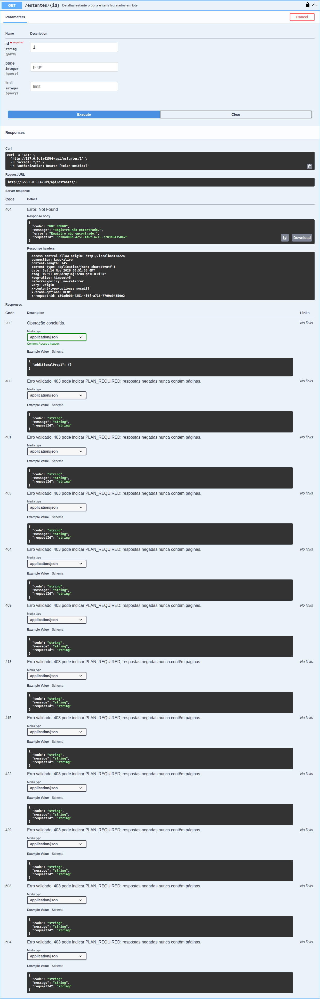

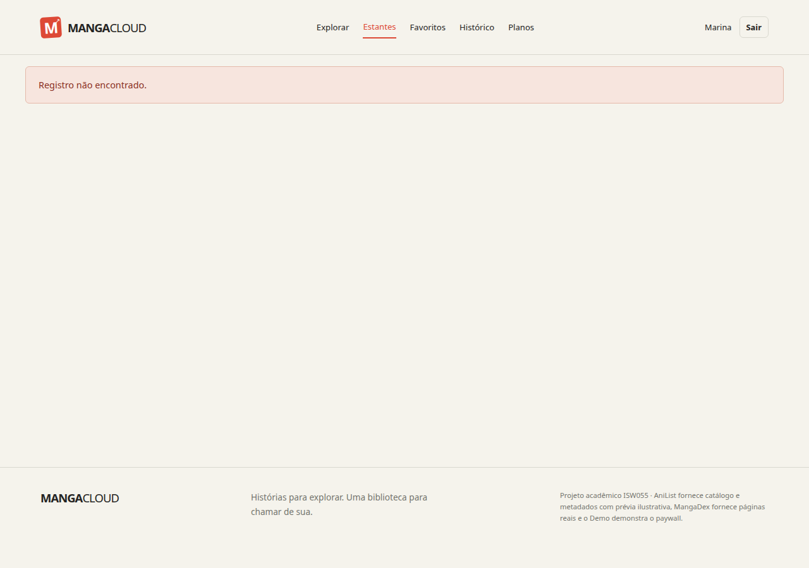

### Auditoria e logs de negócio (`/admin`) + saúde das fontes (`/curadoria`)
Registro em tempo real no Redis Streams consumido pelo Painel Admin (`estante.criada`, `estante.capa_enviada`, `estante.item_adicionado`, `estante.limite_atingido`, `acesso.negado HTTP 403`, `acesso.negado HTTP 404`, `leitura.liberada`, `leitura.bloqueada`) e visão técnica de curadoria:

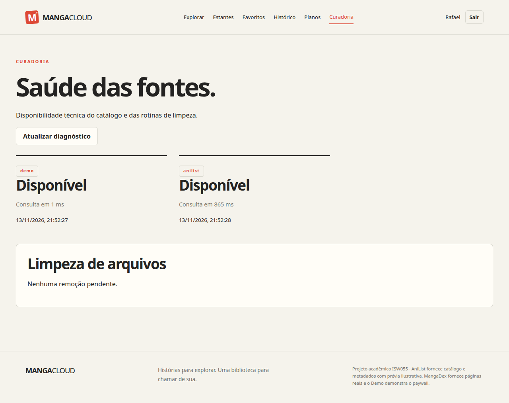
