# Documentação e Evidências — Atividade 10 (MangaCloud)

Pasta organizada para reunir a documentação de apresentação e as capturas de tela do projeto **MangaCloud** (disciplina **ISW055**, professor **@siriani**).

- **Repositório:** `https://github.com/Paulo794/Manga-Cloud`
- **Commit base da aplicação (`main`):** `ce8cd24`

> **Importante:** as capturas reunidas abaixo documentam a aplicação e os fluxos executados em ambiente local/QA (`localhost:8224` e prévia ao vivo em loopback). Conforme o checklist da disciplina, a publicação final da issue deve confirmar e anexar também os prints coletados diretamente no subdomínio público e no Portainer (`1 GB` por container, `403`, `404/403`, Painel Admin e MinIO).

---

## Índice de Evidências (`imagens/`)

| # | Arquivo | Seção / Fluxo Demonstrado |
| :---: | --- | --- |
| 01 | [`01-landing-sem-login.png`](imagens/01-landing-sem-login.png) | Landing page aberta sem login e apresentação da proposta |
| 02 | [`02-catalogo-demo.png`](imagens/02-catalogo-demo.png) | Catálogo Demo identificado com 3 obras sintéticas |
| 03 | [`03-obra-demo.png`](imagens/03-obra-demo.png) | Página da obra Demo mostrando capítulos Free (1 a 3) e bloqueio Pro (4) |
| 04 | [`04-estantes-com-capa-minio.png`](imagens/04-estantes-com-capa-minio.png) | Minhas Estantes privadas com capa personalizada armazenada no MinIO |
| 05 | [`05-leitor-web-demo.png`](imagens/05-leitor-web-demo.png) | Leitor web paginado aberto no capítulo demonstrativo |
| 06 | [`06-swagger-openapi.png`](imagens/06-swagger-openapi.png) | Documentação interativa da API no Swagger (`/api-docs`) |
| 07 | [`07-catalogo-anilist-ao-vivo.png`](imagens/07-catalogo-anilist-ao-vivo.png) | Catálogo real carregado via **API pública AniList** (`12/12` capas reais) |
| 08 | [`08-catalogo-mangadex-ao-vivo.png`](imagens/08-catalogo-mangadex-ao-vivo.png) | Catálogo real carregado via **API MangaDex** (`12/12` capas reais via proxy) |
| 09 | [`09-stripe-assinatura-confirmada.png`](imagens/09-stripe-assinatura-confirmada.png) | Fluxo de assinatura Pro com Stripe teste confirmado e gestão de renovação |
| 10 | [`10-leitor-slime-capa.png`](imagens/10-leitor-slime-capa.png) | Leitura real no navegador — *Tensei Shitara Slime Datta Ken* (capa/arte) |
| 11 | [`11-leitor-slime-mangadex-capitulo.png`](imagens/11-leitor-slime-mangadex-capitulo.png) | Leitor web autenticado em capítulo real MangaDex (*O Fim da Humilhação*, pág. 4/48) |
| 12 | [`12-leitor-solo-leveling-ptbr.png`](imagens/12-leitor-solo-leveling-ptbr.png) | Leitura de página real em PT-BR — *Solo Leveling* |
| 13 | [`13-leitor-kumo-desu-ga-ptbr.png`](imagens/13-leitor-kumo-desu-ga-ptbr.png) | Leitura de página real em PT-BR — *Kumo desu ga, Nani ka?* (#73-1) |

---

## 1. Landing Page, Catálogos e API

### Landing Page aberta sem login

### Catálogo real — AniList (provedor padrão configurado)
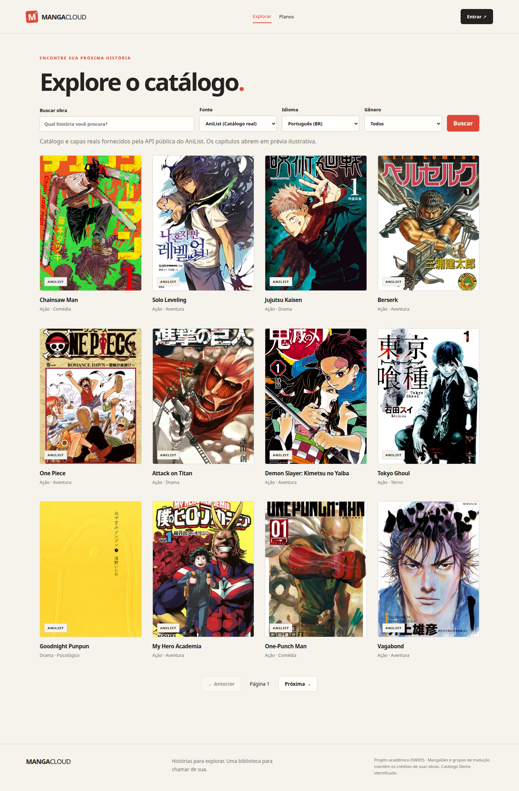

### Catálogo real — MangaDex (capas servidas via proxy do backend)
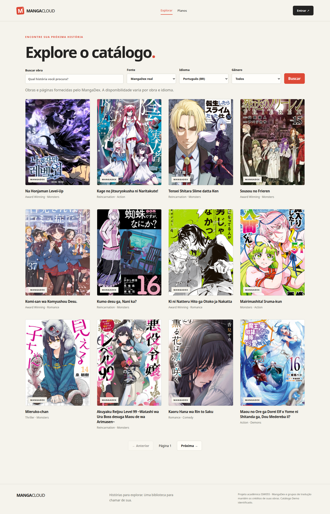

### Catálogo Demo identificado (validação de regras e paywall)
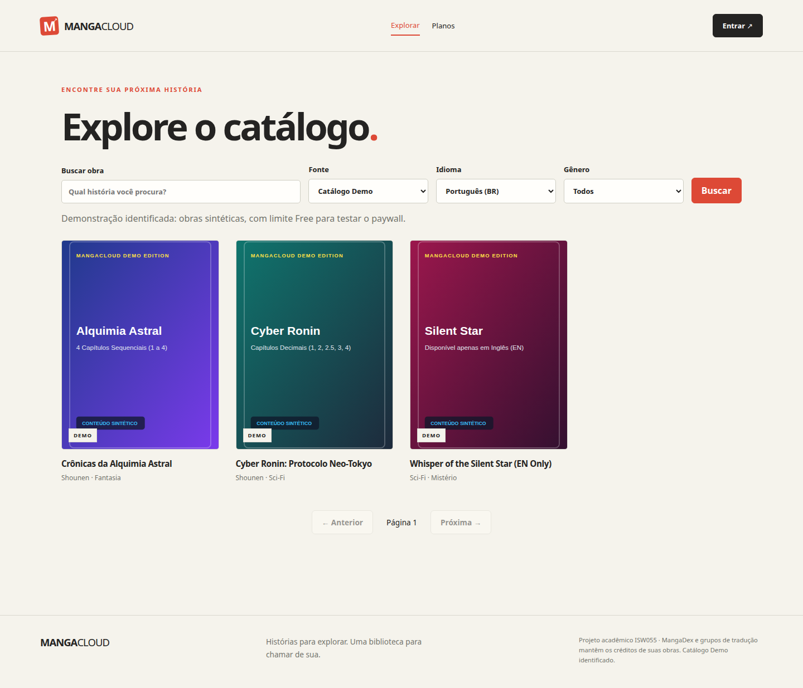

### Documentação OpenAPI / Swagger (`/api-docs`)
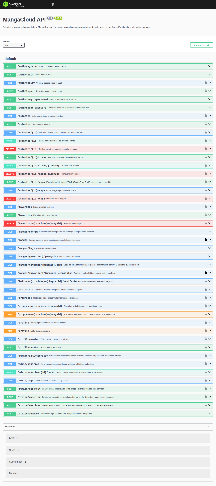

---

## 2. Estantes Privadas (MinIO), Obra, Paywall e Assinatura Stripe

### Listagem de Estantes Privadas com capa no MinIO
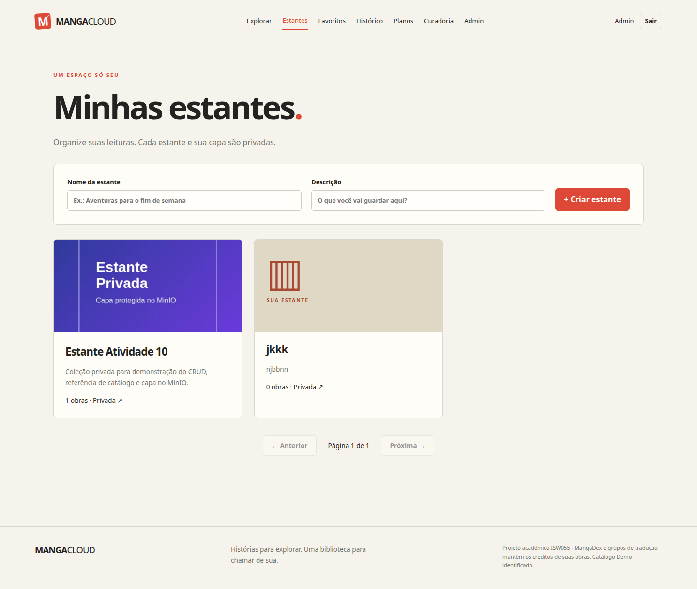

### Detalhe da obra e controle Free / Pro
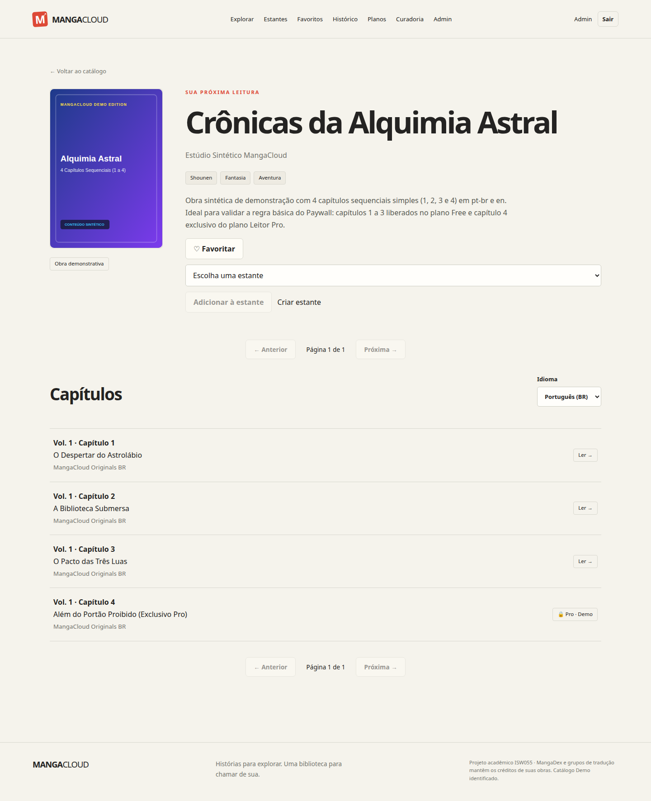

### Assinatura Pro confirmada (Stripe em modo teste)
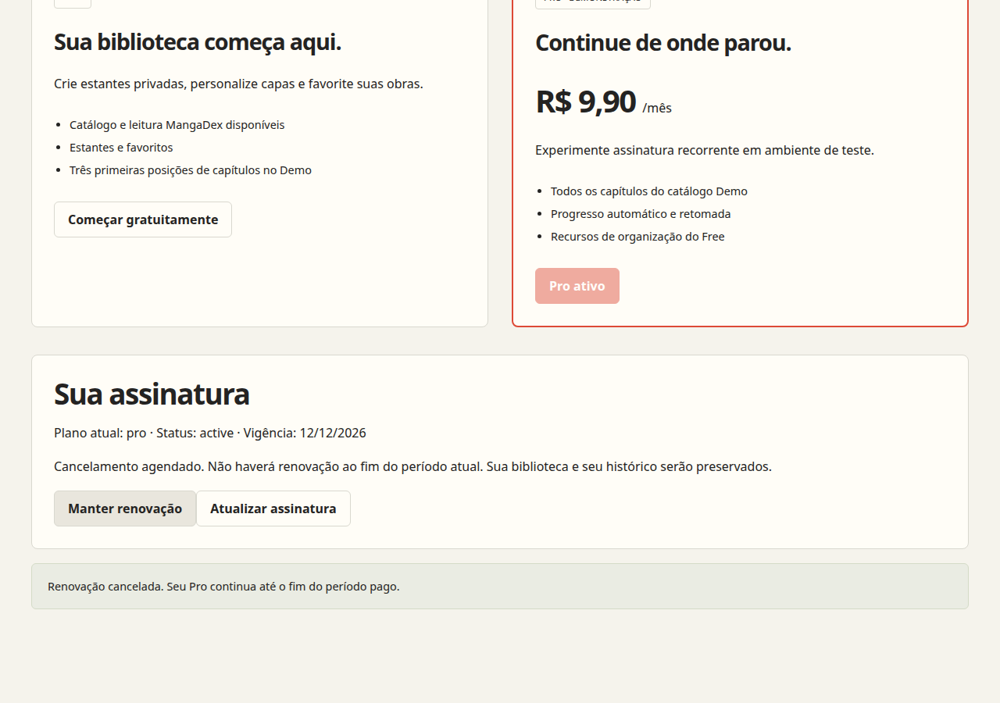

---

## 3. Leitor Web e Páginas Reais em PT-BR

### Leitor Web — Modo Demonstração
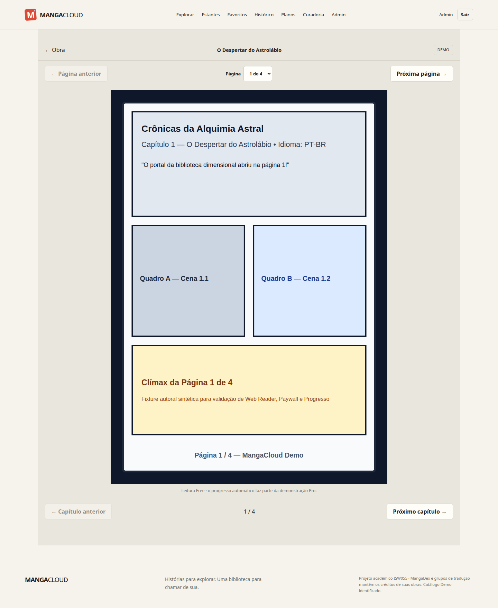

### Leitor Web — Capítulo real MangaDex (*O Fim da Humilhação*, pág. 4 de 48)
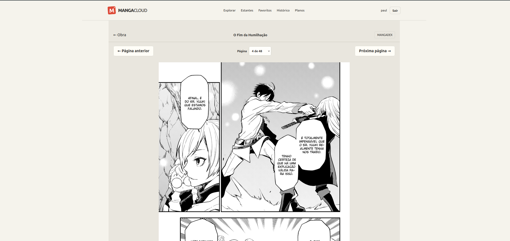

### Páginas reais exibidas no leitor — *Tensei Shitara Slime Datta Ken*
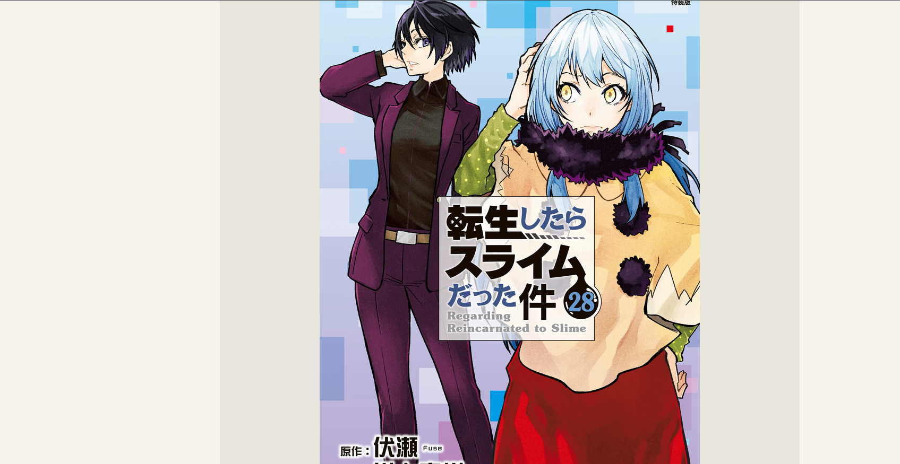

### Páginas reais exibidas no leitor — *Solo Leveling* (PT-BR)
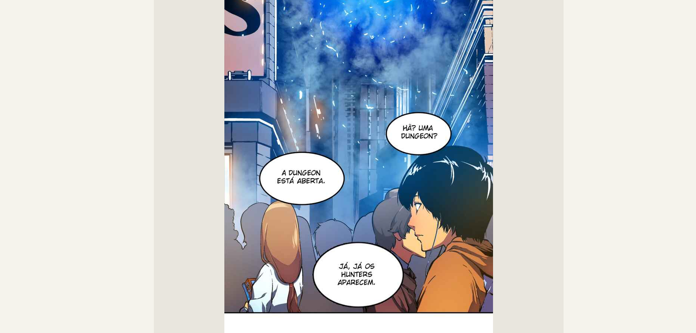

### Páginas reais exibidas no leitor — *Kumo desu ga, Nani ka?* (PT-BR)
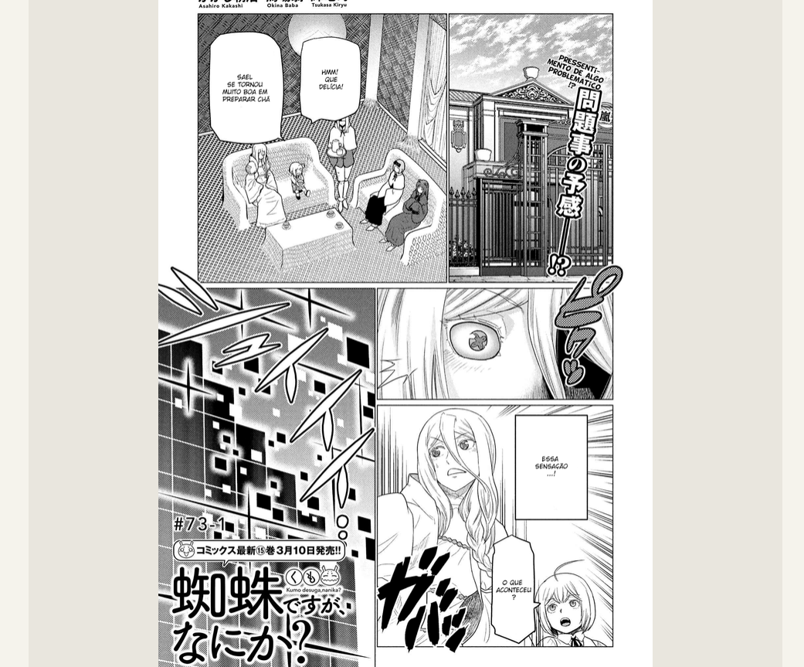
