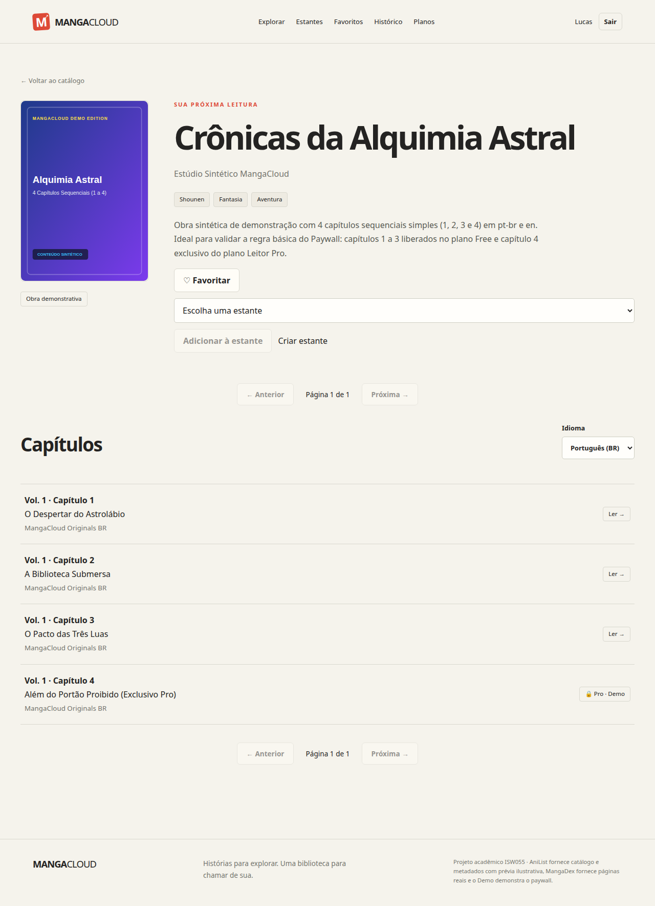
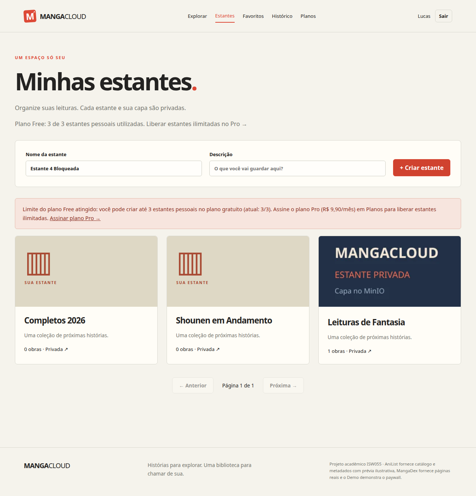
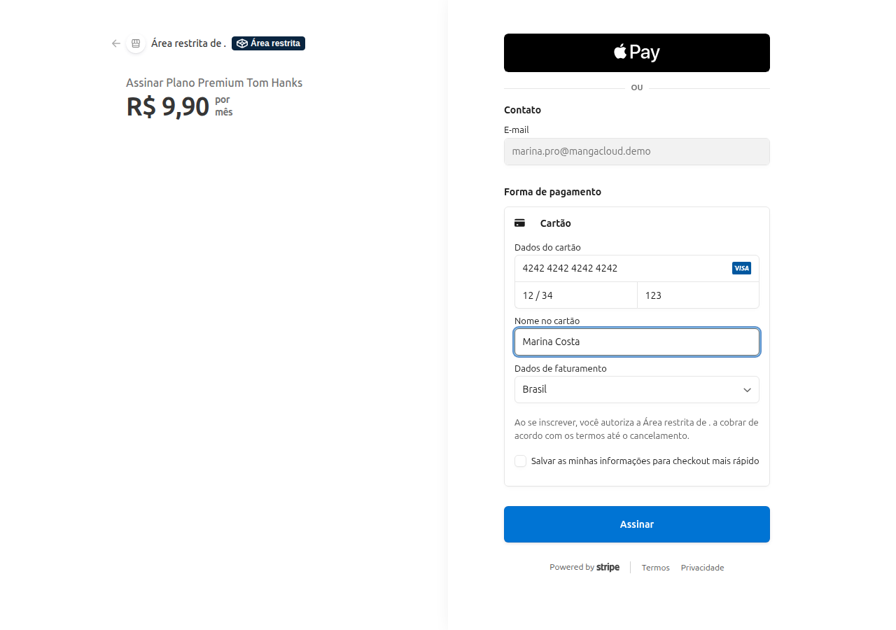
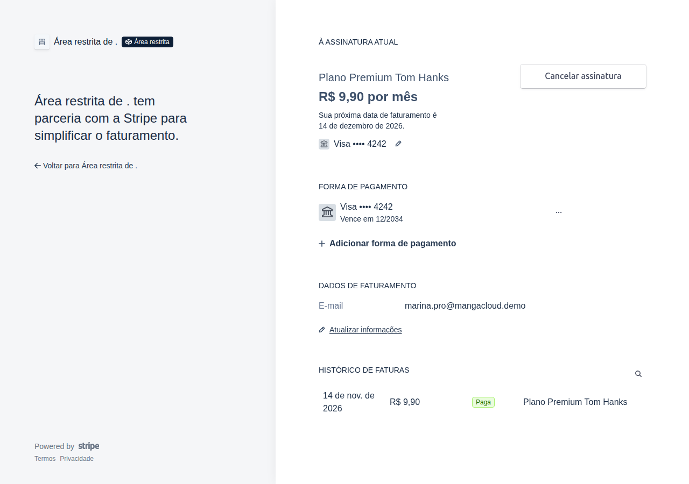
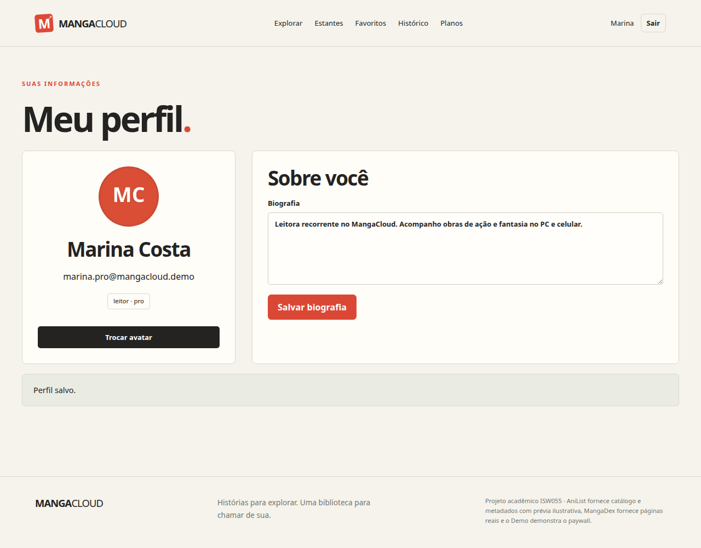
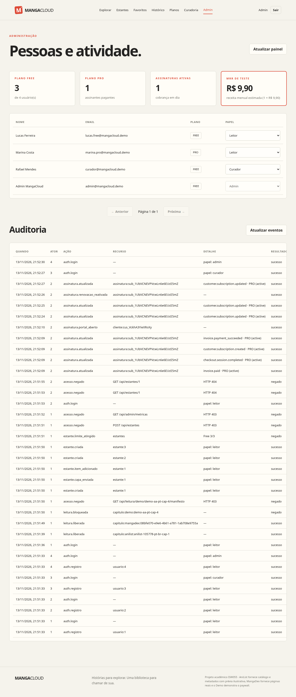

# Documentação e Evidências — Atividade 11 (SaaS completo com Stripe)

Pasta organizada com a documentação, matriz de testes (Stripe teste ao vivo vs. simulação) e capturas de tela da **Atividade 11** do **MangaCloud** (disciplina **ISW055**, professor **@siriani**).

- **Repositório:** `https://github.com/Paulo794/Manga-Cloud`
- **Commit base registrado:** `ad96047` (com consolidação local de **13/11/2026**, incluindo correção de reativação quando o Stripe Billing Portal agenda cancelamento com `cancel_at`)
- **Data das capturas e da validação ao vivo:** **13/11/2026**
- **Ambiente:** **Ambiente local isolado** (`http://127.0.0.1` com MariaDB `11.8`, MinIO, Redis em loopback) integrado ao **Stripe real em modo de teste** via API + Stripe Checkout (`checkout.stripe.com`) + Stripe Billing Portal (`billing.stripe.com`) + Stripe CLI webhook listener, utilizando exclusivamente contas sintéticas `@mangacloud.demo`.

> [!IMPORTANT]
> **O que está comprovado ao vivo x o que permanece pendente:**
> - **Comprovado ao vivo em 13/11/2026 (Stripe modo teste):** criação de 3 estantes no Free → bloqueio da 4ª estante (`403 PLAN_REQUIRED`) → Checkout recorrente real (`4242`, **R$ 9,90/mês**) → confirmação por webhook assinado e idempotente (`checkout.session.completed`, `customer.subscription.created`, `invoice.payment_succeeded`, `invoice.paid`) → liberação da 4ª estante e atualização de métricas/MRR no `/admin` → abertura real do **Stripe Billing Portal** (`billing.stripe.com`) → agendamento de cancelamento no Portal (`at_period_end`) → reativação → avanço via **Stripe Test Clocks** (fim automático do período com retorno ao Free preservando dados + simulação controlada de pagamento recusado `invoice.payment_failed` com status `past_due`, alerta de inadimplência e reversão para Free).
> - **Pendências concretas da Atividade 11:**
>   1. Print atualizado do **Stripe Dashboard web (modo de teste)** mostrando a assinatura e as faturas geradas após as mudanças do Billing Portal (há registros históricos de 12/11 antes das alterações recentes, mantidos apenas como histórico e não apresentados como prova do fluxo atual do Portal);
>   2. Repetição do fluxo completo no **subdomínio público / Portainer** com URL HTTPS pública de retorno e webhook configurado no Stripe Dashboard.

---

## Regras Validadas

- **Separação entre papel e plano:** papéis (`leitor`, `curador`, `admin`) não concedem benefício financeiro; o acesso ao **Pro** depende exclusivamente de assinatura vigente no banco (`status` ativo dentro da vigência e não inadimplente).
- **Free (`R$ 0,00/mês`):** catálogo AniList com **prévia ilustrativa**, páginas reais do MangaDex, **até 3 estantes pessoais** no backend (`POST /api/estantes` retorna `403 PLAN_REQUIRED` na 4ª) e 3 primeiras posições canônicas do Demo.
- **Pro (`R$ 9,90/mês` em Stripe teste):** estantes pessoais ilimitadas, todos os capítulos do Demo liberados, histórico completo e gestão via Stripe Billing Portal.
- **Política de cancelamento:** configurada como `at_period_end` no Stripe Billing Portal (`Cancelar renovação` / Portal mantém o acesso até `vigência` e retorna para **Free** ao fim do ciclo, preservando estantes já criadas e histórico).

---

## Transparência: Stripe Teste ao Vivo vs. Simulação

| Cenário verificado em 13/11/2026 | Executor / Evidência | Modo de execução |
| --- | --- | --- |
| Limite Free (3 estantes ok, 4ª bloqueada com `403 PLAN_REQUIRED`) + evento `estante.limite_atingido` | `run-phase2-mariadb.review.py --stripe-live --stripe-clocks` | Backend real + MariaDB real + navegador Playwright |
| Checkout recorrente `4242` (`R$ 9,90/mês` BRL) + webhooks reais via Stripe CLI (`whsec_...`) + idempotência | `--stripe-live` (`docs/qa/evidencias/stripe-live.json`) | **Stripe real em modo de teste ao vivo** |
| Liberação da 4ª estante no Pro + atualização em `/admin/metricas` (`Pro +1`, `Ativas +1`, `MRR +R$ 9,90`) | `--stripe-live` | **Stripe real em modo de teste ao vivo** + MariaDB |
| Abertura real do Stripe Billing Portal (`billing.stripe.com`), cancelamento no Portal (`cancel_at`) e reativação na UI | `--stripe-live` | **Stripe Billing Portal real em modo de teste** |
| Fim do período contratado retornando conta ao Free (preservando dados e bloqueando nova estante extra + revertendo MRR) | `--stripe-live --stripe-clocks` | **Stripe Test Clocks reais em modo de teste** |
| Inadimplência (`invoice.payment_failed` com Test Clock em cartão de recusa controlada → `past_due`, alerta visual e revogação do Pro) | `--stripe-live --stripe-clocks` | **Stripe Test Clocks + webhook real `invoice.payment_failed`** |
| Regressão offline de idempotência duplicada e webhook sem acesso à internet (`HTTP-5`) | `run-phase2-mariadb.review.py --api` | **Simulação explícita local** (HMAC válido, exclusivamente para testes offline) |

---

## Evidências Visuais Locais (`imagens/` — capturadas em 13/11/2026)

### 1. Paywall no catálogo Demo e limite Free nas estantes (`3/3`)

### 2. Tela de Planos modularizada (`Plans.tsx`) antes da assinatura

### 3. Checkout recorrente Stripe em modo teste (cartão `4242`, `R$ 9,90/mês`)

### 4. Pro confirmado após webhook e botões do Billing Portal

### 5. Stripe Billing Portal ao vivo (`billing.stripe.com`) e cancelamento agendado

### 6. Perfil modularizado (`Profile.tsx`) separado da tela de planos

### 7. Painel Admin: Free vs. Pro, Assinaturas Ativas, MRR de Teste e Trilha de Auditoria
Note na tabela que `Marina Costa` possui papel `Leitor` com plano `PRO` e `Admin MangaCloud` / `Rafael Mendes` possuem papel privilegiado com plano `FREE`, comprovando a separação entre papel e assinatura. Na auditoria constam `estante.limite_atingido`, `checkout.session.completed`, `customer.subscription.created`, `invoice.payment_succeeded`, `assinatura.portal_aberto`, `customer.subscription.updated` e `assinatura.renovacao_reativada`.

---

## Consulte também

- [README principal](../../README.md) — visão do produto, regras dos planos Free/Pro, execução local (`npm start`) e arquitetura;
- [Atividade 10](../atividade-10/README.md) — documentação e capturas da infraestrutura base e controle de acesso.
